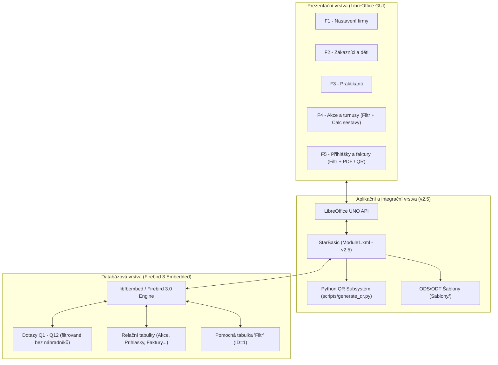

# Programátorská a administrátorská dokumentace – Šťastný statek

> **Verze dokumentu:** 2.5 (Technická a vývojářská specifikace)  
> **Určeno pro:** Vývojáře databázových aplikací LibreOffice, správce systémů a systémové integrátory  
> **Technologie:** LibreOffice Base 26+ (StarBasic / UNO API), Firebird 3.0 Embedded, Python 3.10+, ODF 1.3  
> **Umístění projektu:** `Libre_Office_Base/` a přenosový balíček `Libre_Office_Base_presun/`

---

## 1. Architektura a systémové komponenty

Systém je koncipován jako plně autonomní databázová aplikace typu **Desktop DBMS** běžící na OpenDocument standardu (ODF 1.3 / ISO 26300). Nevyžaduje instalaci samostatného databázového démona; veškeré databázové struktury, aplikační logika a vizuální formuláře jsou zapouzdřeny v souboru `.odb`.



### Systémové závislosti a runtime požadavky
- **LibreOffice:** Verze 26.0+ (Base, Calc, Writer). Vhodné pro nativní instalace i Flatpak (`org.libreoffice.LibreOffice`).
- **Java Runtime Environment (JRE):** Volitelné pro Base Report Builder (pokud jsou sestavy editovány v grafickém návrháři).
- **Python 3:** Verze 3.10+ (používá se pro dávkové zpracování a generování QR plateb přes čistý `zlib` a `struct`).
- **Standardní POSIX nástroje:** `bash`, `zip`, `unzip` pro skript `zalohovat.sh`.

---

## 2. Vnitřní struktura kontejneru `.odb`

Soubor `Šťastný_statek.odb` (či `Stastny_statek.odb`) je komprimovaný archiv typu ZIP splňující specifikaci OASIS ODF.

```text
Šťastný_statek.odb (ZIP)
├── mimetype                             <- application/vnd.sun.xml.base
├── content.xml                          <- Definice SQL dotazů (Q1-Q12) a datových zdrojů
├── settings.xml                         <- Nastavení Base rozhraní
├── database/
│   └── firebird.fbk                     <- Binární záloha/obraz embedded Firebird 3.0
├── Basic/
│   ├── script-lc.xml                    <- Registr knihoven Basicu
│   └── Standard/
│       ├── script-lb.xml                <- Registr modulů knihovny Standard
│       └── Module1.xml                  <- Kompletní zdrojový kód Basic maker (v2.5)
├── forms/
│   ├── Obj11/                          <- Formulář F1 (Nastavení firmy)
│   ├── Obj21/                          <- Formulář F2 (Zákazníci a děti)
│   ├── Obj31/                          <- Formulář F3 (Praktikanti)
│   ├── Obj41/                          <- Formulář F4 (Akce a turnusy + filtrovací lišta)
│   └── Obj51/                          <- Formulář F5 (Přihlášky a faktury + filtrovací lišta)
└── reports/
    └── Obj11/ až Obj111/                <- Tiskové sestavy systému
```

---

## 3. Databázové schéma DDL (Firebird 3)

### Pravidla integrity a ochrana účetních dokladů
Ve verzi 2.5 bylo upraveno omezení cizího klíče `FK_Fakt_Prih` – bylo odstraněno kaskádové mazání (`ON DELETE CASCADE`), aby smazání přihlášky nebo akce nemohlo smazat daňové a účetní doklady.

#### Tabulka `Prihlasky`
```sql
CREATE TABLE "Prihlasky" (
  "ID_Prihlasky"      INTEGER GENERATED BY DEFAULT AS IDENTITY PRIMARY KEY,
  "ID_Akce"           INTEGER NOT NULL,
  "ID_Zakaznika"      INTEGER NOT NULL,
  "ID_Ditete"         INTEGER,
  "Datum_Prihlasky"   DATE NOT NULL,
  "Stav"              VARCHAR(20) DEFAULT 'POTVRZEN',
  "Cena_Celkem"       DECIMAL(10,2) NOT NULL,
  "Zpusob_Platby"     VARCHAR(50) DEFAULT 'PREVOD',
  "Variabilni_Symbol" VARCHAR(20),
  "Poznamka"          VARCHAR(500),
  "Bezinfekcnost"     SMALLINT DEFAULT 0,
  "Datum_Bezinf"      DATE,
  "Urazove_Pojisteni" SMALLINT DEFAULT 0,
  CONSTRAINT "FK_Prih_Akce" FOREIGN KEY ("ID_Akce") REFERENCES "Akce"("ID_Akce"),
  CONSTRAINT "FK_Prih_Zak"  FOREIGN KEY ("ID_Zakaznika") REFERENCES "Zakaznici"("ID_Zakaznika"),
  CONSTRAINT "FK_Prih_Dite" FOREIGN KEY ("ID_Ditete") REFERENCES "Deti"("ID_Ditete")
);
```

#### Tabulka `Faktury`
```sql
CREATE TABLE "Faktury" (
  "ID_Faktury"        INTEGER GENERATED BY DEFAULT AS IDENTITY PRIMARY KEY,
  "ID_Prihlasky"      INTEGER NOT NULL,
  "Typ_Faktury"       VARCHAR(12) NOT NULL,
  "Cislo_Faktury"     VARCHAR(30) NOT NULL,
  "Castka"            DECIMAL(10,2) NOT NULL,
  "Castka_Zaplaceno"  DECIMAL(10,2) DEFAULT 0,
  "Datum_Vystaveni"   DATE NOT NULL,
  "Datum_Splatnosti"  DATE NOT NULL,
  "Datum_Zaplaceno"   DATE,
  "Uhrazeno"          SMALLINT DEFAULT 0,
  "Variabilni_Symbol" VARCHAR(20),
  "Poznamka"          VARCHAR(500),
  CONSTRAINT "FK_Fakt_Prih" FOREIGN KEY ("ID_Prihlasky")
    REFERENCES "Prihlasky"("ID_Prihlasky") -- Bez kaskádového mazání (RESTRICT/NO ACTION) pro ochranu účetních záznamů!
);
```

#### Pomocná tabulka `Filtr`
```sql
CREATE TABLE "Filtr" (
  "ID"         INTEGER GENERATED BY DEFAULT AS IDENTITY PRIMARY KEY,
  "ID_Akce"    INTEGER
);
INSERT INTO "Filtr" ("ID", "ID_Akce") VALUES (1, NULL);
```

---

## 4. Aplikační logika v modulu maker (StarBasic v2.5)

Modul `Module1.xml` obsahuje kompletní aplikační logiku:

### 1. Bezpečné generování faktur (`VytvoritFakturu`)
Procedura v2.5 implementuje:
- **Detekci existujících faktur k přihlášce:** dotazuje `SELECT "Typ_Faktury", "Cislo_Faktury", "Castka" FROM "Faktury" WHERE "ID_Prihlasky"=...`. Pokud již záloha nebo doplatek existují, vyvolá interaktivní varování před duplicitou.
- **Inteligentní výpočet doplatku:** $\text{Doplatek} = \text{Cena celkem} - \sum(\text{Dosud vyfakturováno})$.
- **Respektování termínu splatnosti zálohy:** přebírá pole `Zalohova_Spl` z tabulky `Akce`.
- **Splatnost doplatku:** standardně 14 dní před začátkem akce (`Akce.Datum_Od - 14`).
- **Bezpečné číslování faktur:** zjišťuje `MAX("Cislo_Faktury")` pro daný rok a inkrementuje poslední pořadové číslo namísto nestabilního `COUNT(*)`.

```basic
sRok = Format(Year(Date), "0000")
sSQL = "SELECT ""Cislo_Faktury"" FROM ""Faktury"" WHERE ""Cislo_Faktury"" LIKE '" & sRok & "-%' ORDER BY ""Cislo_Faktury"" DESC"
oResult = oSt.executeQuery(sSQL)
nNext = 1
IF oResult.next() THEN
    DIM sMaxCislo AS STRING
    sMaxCislo = oResult.getString(1)
    DIM nPom AS INTEGER
    nPom = InStr(sMaxCislo, "-")
    IF nPom > 0 THEN
        nNext = VAL(Mid(sMaxCislo, nPom + 1)) + 1
    END IF
END IF
sCislo = sRok & "-" & Format(nNext, "0000")
```

### 2. Generování QR kódů a tisk faktury (`FakturaZID`)
- **Unikátní název souboru:** QR kód je pro každou fakturu generován do samostatného souboru `Dokumenty/qr_faktura_<Cislo>.png`.
- **Ověření návratového stavu a existence:** Makro zjišťuje `FileExists(sQrPath)`. Pokud skript selže, je uživatel varován a nevloží se poškozený objekt.
- **Bezpečný JOIN dodavatele:** Namísto nekontrolovaného `CROSS JOIN` používá `LEFT JOIN "Dodavatele" dd ON dd."ID_Dodavatele"=1`.

### 3. Sjednocení evidence bezinfekčnosti (`OznacitBezinfekcnost`)
Při označení bezinfekčnosti se hodnota atomicky propíše jak do tabulky `Deti`, tak do všech aktivních přihlášek dítěte v tabulce `Prihlasky`:
```basic
oSt.executeUpdate("UPDATE ""Deti"" SET ""Bezinfekcnost""=1,""Datum_Bezinf""='" & sDnes & "' WHERE ""ID_Ditete""=" & nID)
oSt.executeUpdate("UPDATE ""Prihlasky"" SET ""Bezinfekcnost""=1,""Datum_Bezinf""='" & sDnes & "' WHERE ""ID_Ditete""=" & nID & " AND ""Stav"" NOT IN ('STORNO')")
```

---

## 5. SQL Dotazy a tiskové sestavy (content.xml)

Všechny provozní dotazy vylučují stornované přihlášky i náhradníky:

1. **`Q3_Seznam_Ucastniku`:**
   ```sql
   WHERE "Prihlasky"."Stav" NOT IN ('STORNO', 'NAHRADNIK')
   ```
2. **`Q4_Kooperativa` (nepojištěné děti pro pojišťovnu):**
   ```sql
   WHERE ("Deti"."Urazove_Pojisteni" = 0 OR "Deti"."Urazove_Pojisteni" IS NULL)
     AND "Prihlasky"."Stav" NOT IN ('STORNO', 'NAHRADNIK')
     AND ("Filtr"."ID_Akce" IS NULL OR "Akce"."ID_Akce" = "Filtr"."ID_Akce")
   ```
3. **`Q5_Bez_Bezinfekcnosti`:**
   ```sql
   WHERE (COALESCE("Prihlasky"."Bezinfekcnost", 0) = 0 AND COALESCE("Deti"."Bezinfekcnost", 0) = 0)
     AND "Prihlasky"."Stav" NOT IN ('STORNO', 'NAHRADNIK')
     AND ("Filtr"."ID_Akce" IS NULL OR "Akce"."ID_Akce" = "Filtr"."ID_Akce")
   ```
4. **`Q6_Nezaplacene_Zalohy` a `Q7_Nezaplacene_Doplatky`:**
   Dotaz vybírá dosud neuhrazené faktury daného typu seřazené vzestupně podle data splatnosti (`ORDER BY "Faktury"."Datum_Splatnosti"`).
5. **`Q10_Obsazenost_Akce`:**
   Počítá obsazenost podle potvrzených přihlášek a odečítá od kapacity turnusu:
   ```sql
   ("Akce"."Kapacita" - COUNT("Prihlasky"."ID_Prihlasky")) AS "Volna_Mista"
   ```

---

## 6. Python QR generátor (SPAYD Standard)

Skript `scripts/generate_qr.py` je čistě pythonovská implementace (bez PIL a binárních C-rozšíření) zapisující PNG matici přímo pomocí `zlib` a `struct`:
- **Kompatibilita:** Běží v nativním prostředí i ve Flatpak sandboxu.
- **Validace VS:** Limitováno na max. 10 číslic dle specifikace ČNB (`X-VS:0-9{1,10}`).

---

## 7. Administrátorské postupy a zálohování

### Zálohovací skript `zalohovat.sh`
- Automaticky detekuje soubor `Šťastný_statek.odb` i `Stastny_statek.odb`.
- Generuje ZIP archiv do složky `ZAL/` s časovým razítkem:
  `Zaloha_Stastny_statek_YYYY-MM-DD_hh-mm-ss.zip`.
- Aktualizuje čistou kopii do složky `ZAL/latest/`.

### Obnova databáze
1. Ukončit veškeré procesy LibreOffice (`killall soffice.bin`).
2. Nahradit soubor `.odb` v kořenovém adresáři souborem z `ZAL/latest/` nebo rozbaleného archivu.
3. Spustit LibreOffice Base a zkontrolovat integritu dat.
