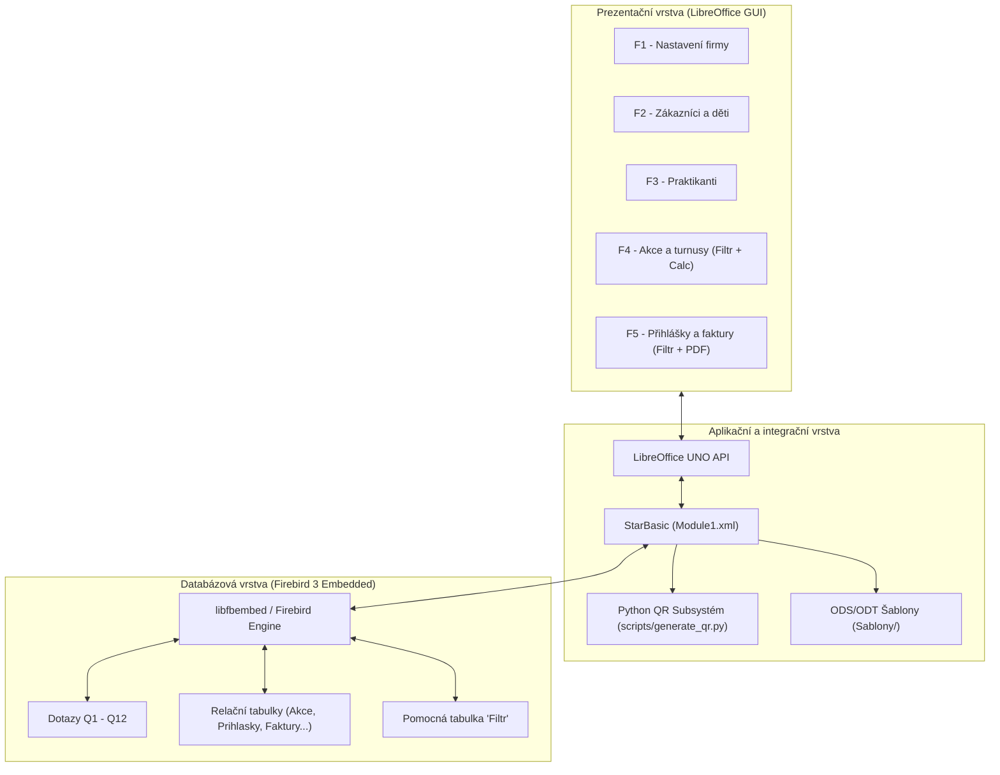
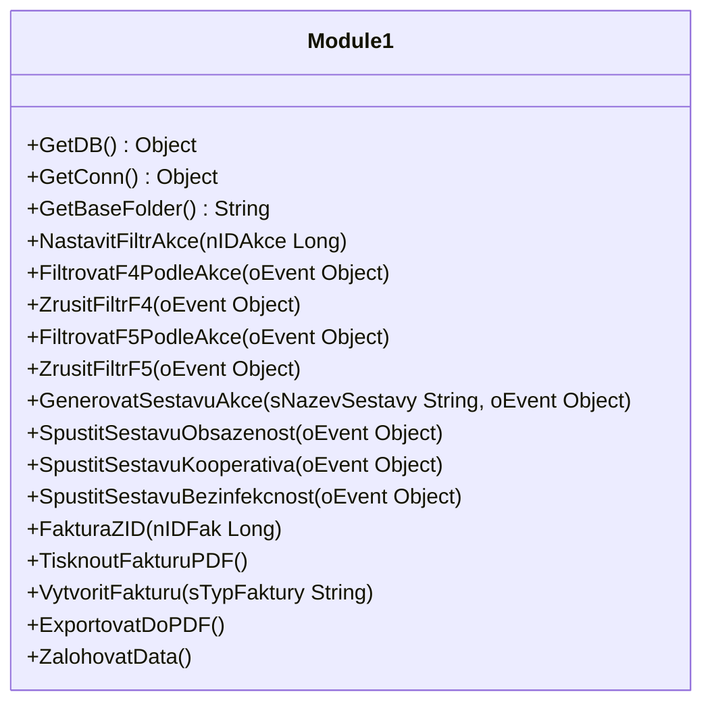

# Programátorská a administrátorská dokumentace – Šťastný statek

> **Verze dokumentu:** 2.0 (Technická specifikace)  
> **Určeno pro:** Vývojáře databázových aplikací LibreOffice, správce systémů a systémové integrátory  
> **Technologie:** LibreOffice Base 26+ (StarBasic / UNO API), Firebird 3.0 Embedded, Python 3.10+, ODF 1.3  
> **Umístění projektu:** `/home/wanbli/Moje_projekty/Evidence_taboru/Libre_Office_Base/`

---

## 1. Architektura a systémové komponenty

Systém je koncipován jako plně autonomní databázová aplikace typu **Desktop DBMS** běžící na OpenDocument standardu (ODF 1.3 / ISO 26300). Nevyžaduje instalaci samostatného databázového démona; veškeré databázové struktury, aplikační logika a vizuální formuláře jsou zapouzdřeny v souboru `.odb`.



### Systémové závislosti a runtime požadavky
- **LibreOffice:** Verze 26.0+ (Base, Calc, Writer). Vhodné pro nativní instalace i Flatpak (`org.libreoffice.LibreOffice`).
- **Java Runtime Environment (JRE):** Volitelné pro Base Report Builder (pokud jsou sestavy editovány v grafickém návrháři).
- **Python 3:** Verze 3.10+ (používá se pro dávkové zpracování a generování QR plateb).
- **Standardní POSIX nástroje:** `bash`, `zip`, `unzip` pro skript `zalohovat.sh`.

---

## 2. Vnitřní struktura kontejneru `.odb`

Soubor [Šťastný_statek.odb](file:///home/wanbli/Moje_projekty/Evidence_taboru/Libre_Office_Base/%C5%A0%C5%A5astn%C3%BD_statek.odb) je komprimovaný archiv typu ZIP splňující specifikaci OASIS ODF.

```text
Šťastný_statek.odb
├── mimetype                               # Typ dokumentu (musí být nekomprimovaný na offsetu 0)
├── content.xml                            # Globální schéma: dotazy (Q1-Q12), registrace formulářů a sestav
├── settings.xml                           # Konfigurace Base ovladače a připojení
├── META-INF/
│   └── manifest.xml                       # Manifest všech komponent a jejich MIME typů
├── Basic/Standard/
│   ├── script-lc.xml                      # Registrace knihovny StarBasic
│   └── Module1.xml                        # Kompletní zdrojový kód Basic maker
├── database/
│   └── firebird.fbk                       # GBAK komprimovaný archiv databáze Firebird
├── forms/
│   ├── Obj11/ (F1 - Nastavení firmy)      # XML model, styly a layout formuláře
│   ├── Obj21/ (F2 - Zákazníci a děti)
│   ├── Obj31/ (F3 - Praktikanti)
│   ├── Obj41/ (F4 - Akce a turnusy)
│   └── Obj51/ (F5 - Přihlášky a faktury)
└── reports/
    ├── Obj11/ (rpt_SeznamUcastniku_Writer)
    ├── Obj21/ (rpt_SeznamUcastniku_Calc)
    ├── Obj31/ (rpt_Kooperativa_Calc)
    ├── Obj41/ (rpt_BezBezinfekcnosti_Calc)
    ├── Obj51/ (rpt_NezaplaceneZalohy_Calc)
    ├── Obj61/ (rpt_NezaplaceneDoplatky_Calc)
    ├── Obj71/ (rpt_PrehledPrijmu_Calc)
    ├── Obj81/ (rpt_Upozorneni_Rodice_Calc)
    ├── Obj91/ (rpt_Obsazenost_Calc)
    ├── Obj101/ (rpt_Nahradnici_Calc)
    └── Obj111/ (rpt_Praktikanti_Calc)
```

> [!CAUTION]
> **Pravidlo pro balení ODB archivů:** Při programové modifikaci souboru `.odb` musí být položka `mimetype` vložena do archivu jako **první soubor**, zcela **bez komprese (`zipfile.ZIP_STORED`)**. V opačném případě LibreOffice vyhodnotí soubor jako poškozený!

---

## 3. Databázové schéma a SQL dotazy (Firebird 3)

### Fyzické tabulky a integritní omezení

#### Tabulka `Dodavatele`
Obsahuje identifikační údaje provozovatele. Využívá se přes `CROSS JOIN` v dotazech fakturace.
```sql
CREATE TABLE "Dodavatele" (
  "ID_Dodavatele"   INTEGER GENERATED BY DEFAULT AS IDENTITY PRIMARY KEY,
  "Nazev_Firmy"     VARCHAR(200) NOT NULL,
  "Jmeno"           VARCHAR(50),
  "Prijmeni"        VARCHAR(50),
  "ICO"             VARCHAR(20),
  "DIC"             VARCHAR(20),
  "Ulice_CP"        VARCHAR(100),
  "Mesto"           VARCHAR(50),
  "PSC"             VARCHAR(10),
  "Telefon"         VARCHAR(20),
  "Email"           VARCHAR(100),
  "Web"             VARCHAR(100),
  "Banka"           VARCHAR(100),
  "Cislo_Uctu"      VARCHAR(50),
  "IBAN"            VARCHAR(50),
  "Logo_Cesta"      VARCHAR(500)
);
```

#### Tabulka `Zakaznici`
Objednatelé, rodiče a plátci.
```sql
CREATE TABLE "Zakaznici" (
  "ID_Zakaznika"    INTEGER GENERATED BY DEFAULT AS IDENTITY PRIMARY KEY,
  "Jmeno"           VARCHAR(50) NOT NULL,
  "Prijmeni"        VARCHAR(50) NOT NULL,
  "Telefon"         VARCHAR(20),
  "Email"           VARCHAR(100),
  "Ulice_CP"        VARCHAR(100),
  "Mesto"           VARCHAR(50),
  "PSC"             VARCHAR(10),
  "ICO"             VARCHAR(20),
  "DIC"             VARCHAR(20),
  "Poznamka"        VARCHAR(500)
);
```

#### Tabulka `Deti`
Účastníci pobytových akcí navázaní na rodiče (cizí klíč `FK_Deti_Rodic` s kaskádovým mazáním).
```sql
CREATE TABLE "Deti" (
  "ID_Ditete"             INTEGER GENERATED BY DEFAULT AS IDENTITY PRIMARY KEY,
  "ID_Rodic"              INTEGER NOT NULL,
  "Jmeno"                 VARCHAR(50) NOT NULL,
  "Prijmeni"              VARCHAR(50) NOT NULL,
  "Datum_Narozeni"        DATE NOT NULL,
  "Zdravotni_Pojistovna"  VARCHAR(100),
  "Cislo_Pojistky"        VARCHAR(30),
  "Urazove_Pojisteni"     SMALLINT DEFAULT 0,
  "Zdravotni_Omezeni"     VARCHAR(500),
  "Bezinfekcnost"         SMALLINT DEFAULT 0,
  "Datum_Bezinf"          DATE,
  "Poznamka"              VARCHAR(500),
  CONSTRAINT "FK_Deti_Rodic" FOREIGN KEY ("ID_Rodic")
    REFERENCES "Zakaznici"("ID_Zakaznika") ON DELETE CASCADE
);
```

#### Tabulka `Akce`
Turnusy táborů, víkendy a vyjížďky.
```sql
CREATE TABLE "Akce" (
  "ID_Akce"         INTEGER GENERATED BY DEFAULT AS IDENTITY PRIMARY KEY,
  "Typ_Akce"        VARCHAR(50) NOT NULL,
  "Nazev"           VARCHAR(200) NOT NULL,
  "Datum_Od"        DATE NOT NULL,
  "Datum_Do"        DATE,
  "Kapacita"        INTEGER NOT NULL,
  "Cena_Celkem"     DECIMAL(10,2) NOT NULL,
  "Zalohova_Castka" DECIMAL(10,2) DEFAULT 0,
  "Zalohova_Spl"    DATE,
  "Poznamka"        VARCHAR(500),
  "Aktivni"         SMALLINT DEFAULT 1
);
```

#### Tabulka `Prihlasky`
Středobod agendy propojující Akci, Zákazníka a Dítě.
```sql
CREATE TABLE "Prihlasky" (
  "ID_Prihlasky"      INTEGER GENERATED BY DEFAULT AS IDENTITY PRIMARY KEY,
  "ID_Akce"           INTEGER NOT NULL,
  "ID_Zakaznika"      INTEGER NOT NULL,
  "ID_Ditete"         INTEGER,
  "Datum_Prihlasky"   DATE NOT NULL,
  "Stav"              VARCHAR(20) DEFAULT 'POTVRZEN',
  "Cena_Celkem"       DECIMAL(10,2) NOT NULL,
  "Zpusob_Platby"     VARCHAR(50) DEFAULT 'PREVOD',
  "Variabilni_Symbol" VARCHAR(20),
  "Poznamka"          VARCHAR(500),
  "Bezinfekcnost"     SMALLINT DEFAULT 0,
  "Urazove_Pojisteni" SMALLINT DEFAULT 0,
  CONSTRAINT "FK_Prih_Akce" FOREIGN KEY ("ID_Akce") REFERENCES "Akce"("ID_Akce"),
  CONSTRAINT "FK_Prih_Zak"  FOREIGN KEY ("ID_Zakaznika") REFERENCES "Zakaznici"("ID_Zakaznika"),
  CONSTRAINT "FK_Prih_Dite" FOREIGN KEY ("ID_Ditete") REFERENCES "Deti"("ID_Ditete")
);
```

#### Tabulka `Faktury`
Evidence zálohových, doplatkových a celkových faktur.
```sql
CREATE TABLE "Faktury" (
  "ID_Faktury"        INTEGER GENERATED BY DEFAULT AS IDENTITY PRIMARY KEY,
  "ID_Prihlasky"      INTEGER NOT NULL,
  "Typ_Faktury"       VARCHAR(12) NOT NULL,
  "Cislo_Faktury"     VARCHAR(30) NOT NULL,
  "Castka"            DECIMAL(10,2) NOT NULL,
  "Castka_Zaplaceno"  DECIMAL(10,2) DEFAULT 0,
  "Datum_Vystaveni"   DATE NOT NULL,
  "Datum_Splatnosti"  DATE NOT NULL,
  "Datum_Zaplaceno"   DATE,
  "Uhrazeno"          SMALLINT DEFAULT 0,
  "Variabilni_Symbol" VARCHAR(20),
  "Poznamka"          VARCHAR(500),
  CONSTRAINT "FK_Fakt_Prih" FOREIGN KEY ("ID_Prihlasky") REFERENCES "Prihlasky"("ID_Prihlasky") ON DELETE CASCADE
);
```

#### Pomocná tabulka `Filtr`
Slouží k dynamickému předávání parametrů mezi formuláři a tiskovými sestavami. Obsahuje vždy maximálně jeden záznam s `ID = 1`.
```sql
CREATE TABLE "Filtr" (
  "ID"         INTEGER GENERATED BY DEFAULT AS IDENTITY PRIMARY KEY,
  "ID_Akce"    INTEGER
);
INSERT INTO "Filtr" ("ID", "ID_Akce") VALUES (1, NULL);
```

---

### Klíčové SQL dotazy a mechanismus parametrického filtrování

Zatímco formuláře LibreOffice Base podporují přímé filtrování přes `oForm.Filter`, tiskové sestavy Report Builderu vyžadují data z dotazu. Pro umožnění filtrace sestavy podle aktuálně zvolené akce využívají dotazy vazbu `LEFT JOIN "Filtr" ON "Filtr"."ID" = 1`.

#### Příklad dotazu `Q10_Obsazenost_Akce`
```sql
SELECT 
  "Akce"."ID_Akce", 
  "Akce"."Nazev", 
  "Akce"."Typ_Akce", 
  "Akce"."Datum_Od", 
  "Akce"."Kapacita", 
  COUNT("Prihlasky"."ID_Prihlasky") AS "Pocet_Prihlasenych", 
  ("Akce"."Kapacita" - COUNT("Prihlasky"."ID_Prihlasky")) AS "Volna_Mista" 
FROM "Akce" 
LEFT JOIN "Filtr" ON "Filtr"."ID" = 1 
LEFT JOIN "Prihlasky" ON "Akce"."ID_Akce" = "Prihlasky"."ID_Akce" 
  AND "Prihlasky"."Stav" NOT IN ('STORNO', 'NAHRADNIK') 
WHERE ("Filtr"."ID_Akce" IS NULL OR "Akce"."ID_Akce" = "Filtr"."ID_Akce") 
GROUP BY "Akce"."ID_Akce", "Akce"."Nazev", "Akce"."Typ_Akce", "Akce"."Datum_Od", "Akce"."Kapacita" 
ORDER BY "Akce"."Datum_Od"
```

> [!TIP]
> **Mechanismus filtru:**
> - Pokud je `"Filtr"."ID_Akce"` rovno `NULL`, podmínka `("Filtr"."ID_Akce" IS NULL)` je pravdivá pro všechny řádky → dotaz vrací **všechny akce**.
> - Pokud makro zapíše do tabulky `"Filtr"` konkrétní `ID_Akce`, podmínka zúží výsledek **pouze na vybranou akci**.

Stejný princip je aplikován v dotazech `Q4_Kooperativa` (pojišťovna) a `Q5_Bez_Bezinfekcnosti`.

---

## 4. StarBasic makra a integrace s UNO API

Veškerý kód aplikační logiky je uložen v souboru `Basic/Standard/Module1.xml` uvnitř `.odb`.

### Klíčové procedury a jejich funkce



### 1. Dynamická detekce základního adresáře (`GetBaseFolder`)
Nahradila původní pevně zapsané absolutní cesty. Umožňuje bezproblémový přenos celého projektu mezi různými operačními systémy a uživatelskými účty:

```basic
FUNCTION GetBaseFolder() AS STRING
    DIM oDBDoc AS OBJECT
    DIM sURL AS STRING
    DIM nPos AS INTEGER, nNext AS INTEGER
    
    oDBDoc = GetDB()
    IF NOT ISNULL(oDBDoc) AND NOT ISEMPTY(oDBDoc) THEN
        IF oDBDoc.hasLocation() THEN
            sURL = oDBDoc.getLocation()
            nPos = 0
            nNext = InStr(1, sURL, "/")
            DO WHILE nNext > 0
                nPos = nNext
                nNext = InStr(nPos + 1, sURL, "/")
            LOOP
            IF nPos > 0 THEN
                GetBaseFolder = ConvertFromURL(Left(sURL, nPos))
                EXIT FUNCTION
            END IF
        END IF
    END IF
    GetBaseFolder = "/home/wanbli/Moje_projekty/Evidence_taboru/Libre_Office_Base/"
END FUNCTION
```

### 2. Generování faktury a dynamické vložení QR platby (`FakturaZID`)
Procedura načte parametry faktury z Firebirdu, otevře příslušnou šablonu Calc (`.ods`), naplní buňky a následně:
1. Spustí skript `generate_qr.py` přes rozhraní `Shell()`.
2. Do buňky `(1, 42)` vepíše popisek `QR platba`.
3. Získá `DrawPage` listu Calc, vyhledá objekt tvaru s názvem `QR_Platba` a aktualizuje jeho vlastnost `GraphicURL`:

```basic
sScriptQR = GetBaseFolder() & "scripts/generate_qr.py"
sQrPath = GetBaseFolder() & "Dokumenty/qr_faktura.png"

sParamQR = sScriptQR & " --iban " & Chr(34) & sIBAN & Chr(34) & _
           " --amount " & dC & _
           " --vs " & Chr(34) & sVS & Chr(34) & _
           " --msg " & Chr(34) & sCislo & " " & sDitePrijmeni & Chr(34) & _
           " --output " & Chr(34) & sQrPath & Chr(34)

Shell("python3", 0, sParamQR, TRUE)

oDrawPage = oSheet.getDrawPage()
bQrFound = FALSE
FOR iShp = 0 TO oDrawPage.getCount() - 1
    oShape = oDrawPage.getByIndex(iShp)
    IF oShape.getName() = "QR_Platba" THEN
        oShape.GraphicURL = ConvertToURL(sQrPath)
        bQrFound = TRUE
        EXIT FOR
    END IF
NEXT iShp
```

---

## 5. Python QR subsystém (SPAYD Standard)

Generování platebních kódů zajišťuje skript [scripts/generate_qr.py](file:///home/wanbli/Moje_projekty/Evidence_taboru/Libre_Office_Base/scripts/generate_qr.py).

### Klíčové vlastnosti implementace:
1. **Nezávislost na binárních C-rozšířeních:**  
   Běžná knihovna `Pillow` (PIL) vyžaduje kompilované knihovny (`.so`), které mohou selhat v různých verzích Pythonu (např. rozdíl mezi systémovým Pythonem 3.14 a Pythonem 3.13 ve Flatpak kontejneru). Z tohoto důvodu skript používá čistý algoritmus zápisu binárního PNG formátu s využitím standardních modulů `zlib` a `struct`.
2. **Přibalená knihovna `scripts/lib/`:**  
   Obsahuje balíček `qrcode`. Cesta k němu se přidává do `sys.path` za běhu:
   ```python
   SCRIPT_DIR = os.path.dirname(os.path.abspath(__file__))
   LIB_DIR = os.path.join(SCRIPT_DIR, "lib")
   if os.path.exists(LIB_DIR) and LIB_DIR not in sys.path:
       sys.path.insert(0, LIB_DIR)
   ```
3. **Normalizace a validace SPAYD:**  
   - Odstranění mezer a nepovolených znaků z IBAN.
   - Odstranění české diakritiky z textové zprávy pro banku (`MSG`) pomocí `unicodedata.normalize('NFD')`.
   - Omezení variabilního symbolu (`X-VS`) striktně na maximálně 10 číslic, což předchází odmítnutí QR kódu bankovními validátory.

---

## 6. Správa, údržba a zálohování

### Zálohovací skript `zalohovat.sh`
Skript provádí inkrementální archivaci stavu projektu:
```bash
#!/bin/bash
set -e

BASE_DIR="$(cd "$(dirname "$0")" && pwd)"
ZAL_DIR="$BASE_DIR/ZAL"
LATEST_DIR="$ZAL_DIR/latest"
TIMESTAMP=$(date +"%Y-%m-%d_%H-%M-%S")
ARCHIVE_NAME="Zaloha_Stastny_statek_${TIMESTAMP}.zip"
```
Při každém spuštění:
1. Zkontroluje dostupnost souboru `Šťastný_statek.odb`.
2. Vytvoří kopii aktuálního souboru do `ZAL/latest/`.
3. Vytvoří komprimovaný archiv do `ZAL/` obsahující databázi, šablony a skripty.

### Přímá práce s databází Firebird
Pokud je potřeba provést přímé administrační zásahy do Firebirdu mimo LibreOffice Base:
- Archiv `database/firebird.fbk` uvnitř `.odb` je standardní Firebird backup archiv vytvořený utilitou `gbak`.
- Pro inspekci struktury lze databázi obnovit příkazem:
  ```bash
  gbak -c firebird.fbk firebird.fdb
  ```
- Pro interaktivní SQL konzoli lze využít nástroj `isql-fb`:
  ```bash
  isql-fb firebird.fdb -u SYSDBA -p masterkey
  ```

---

## 7. Vývojářská pravidla pro úpravy (Developer Guidelines)

> [!WARNING]
> **Pravidlo 1 – Escapování v `Module1.xml`:**  
> Veškerý kód StarBasicu uvnitř `.odb` je uložen jako text v XML uzlu `<script:module>`. Všechny relační a logické operátory musí být striktně escapovány:
> - Operátor `&` musí být zapsán jako `&amp;`
> - Operátor `<` musí být zapsán jako `&lt;`
> - Operátor `>` musí být zapsán jako `&gt;`

> [!IMPORTANT]
> **Pravidlo 2 – XML namespaces v `content.xml`:**  
> Při úpravách formulářů v `forms/Obj*/content.xml` nikdy nepoužívejte standardní pythonovskou metodu `ET.write()`, protože odstraňuje nebo přejmenovává prefixy jmenných prostorů (`form:`, `draw:`, `office:`), což vede k poškození formuláře. Používejte regex/stringové nahrazování s následnou validací přes `ET.fromstring()`.

> [!TIP]
> **Pravidlo 3 – Relativní cesty v nových makrech:**  
> Nikdy do kódu nezapisujte absolutní cesty začínající `/home/...` ani `C:\...`. Vždy použijte volání `GetBaseFolder() & "podsložka/"`.
