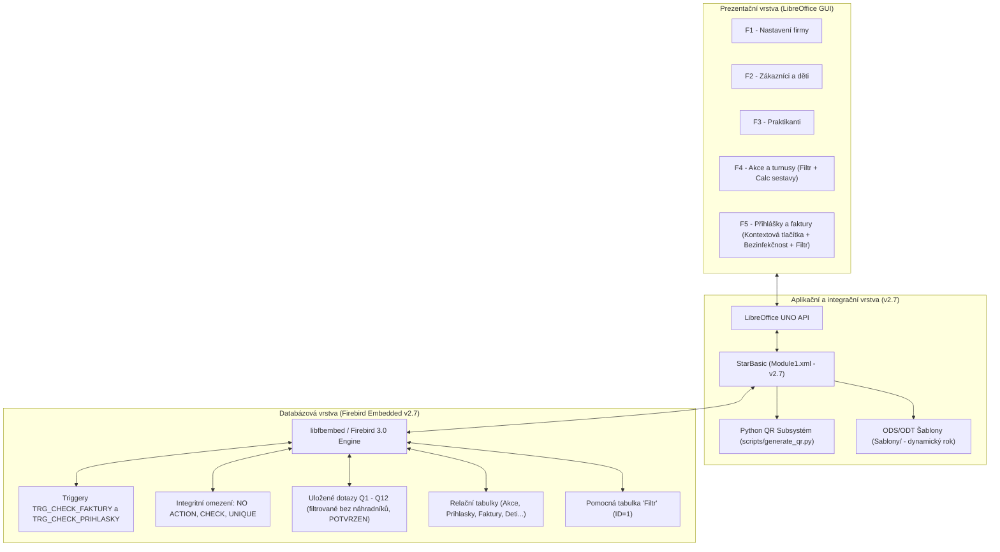

# Programátorská a administrátorská dokumentace – Šťastný statek

> **Verze dokumentu:** 2.7 (Technická a vývojářská specifikace)  
> **Datum vydání:** Listopad 2026  
> **Určeno pro:** Vývojáře databázových aplikací LibreOffice, správce systémů a systémové integrátory  
> **Technologie:** LibreOffice Base 26+ (StarBasic / UNO API), Firebird 3.0+ Embedded, Python 3.10+, ODF 1.3  
> **Umístění projektu:** `Libre_Office_Base/` a přenosový balíček `Libre_Office_Base_presun/`

---

## 1. Architektura a systémové komponenty

Systém je koncipován jako plně autonomní databázová aplikace typu **Desktop DBMS** běžící na OpenDocument standardu (ODF 1.3 / ISO 26300). Nevyžaduje instalaci samostatného databázového serveru; veškeré databázové struktury, aplikační logika a vizuální formuláře jsou zapouzdřeny v souboru `.odb`.



### Systémové závislosti a runtime požadavky
- **LibreOffice:** Verze 26.0+ (Base, Calc, Writer). Vhodné pro nativní instalace i Flatpak (`org.libreoffice.LibreOffice`).
- **Java Runtime Environment (JRE):** Volitelné pro Base Report Builder (pokud jsou sestavy editovány v grafickém návrháři).
- **Python 3:** Verze 3.10+ (používá se pro dávkové zpracování a generování QR plateb přes čistý `zlib` a `struct`).
- **Standardní POSIX nástroje:** `bash`, `zip`, `unzip` pro skript `zalohovat.sh`.

---

## 2. Vnitřní struktura kontejneru `.odb`

Soubor `Šťastný_statek.odb` (či `Stastny_statek.odb`) je komprimovaný archiv typu ZIP splňující specifikaci OASIS ODF:

```text
Šťastný_statek.odb (ZIP)
├── mimetype                             <- application/vnd.sun.xml.base (STORED, nekomprimovaný)
├── content.xml                          <- Definice SQL dotazů (Q1-Q12) a datových zdrojů
├── settings.xml                         <- Nastavení Base rozhraní
├── database/
│   └── firebird.fbk                     <- Binární záloha Firebird 3.0 (header backup version 10)
├── Basic/
│   ├── script-lc.xml                    <- Registr knihoven Basicu
│   └── Standard/
│       ├── script-lb.xml                <- Registr modulů knihovny Standard
│       └── Module1.xml                  <- Zdrojový kód Basic maker (v2.7)
├── forms/
│   ├── Obj11/                          <- Formulář F1 (Nastavení firmy)
│   ├── Obj21/                          <- Formulář F2 (Zákazníci a děti)
│   ├── Obj31/                          <- Formulář F3 (Praktikanti)
│   ├── Obj41/                          <- Formulář F4 (Akce a turnusy + filtrovací lišta)
│   └── Obj51/                          <- Formulář F5 (Přihlášky a faktury + 5 tlačítek)
└── reports/
    └── Obj11/ až Obj111/                <- Tiskové sestavy systému (celkem 11 sestav)
```

---

## 3. Databázové schéma a bezpečnostní pravidla (Firebird 3.0)

Ve verzi 2.7 je integrita dat zajištěna kombinací cizích klíčů, CHECK omezení, unikátních indexů a dvou hlavních triggerů:

### 1. Zrušení kaskádového mazání (ochrana účetních a klientských dat)
- `FK_Fakt_Prih`: `ON DELETE NO ACTION`. Přihlášku s vystavenými fakturami nelze smazat.
- `FK_Prih_Akce`: `ON DELETE NO ACTION`. Akci s existujícími přihláškami nelze smazat.
- `FK_Prih_Zak`: `ON DELETE NO ACTION`. Zákazníka s přihláškami nelze smazat.

### 2. Unikátní omezení (UNIQUE)
- `UQ_FAKT_PRIH_TYP`: `UNIQUE ("ID_Prihlasky", "Typ_Faktury")` – brání více fakturám téhož typu pro jednu přihlášku.
- `UQ_PRIH_VS`: `UNIQUE ("Variabilni_Symbol")` – zaručuje jedinečnost 10místného variabilního symbolu pro každou přihlášku.
- `UQ_PRAK_AKCE`: `UNIQUE ("ID_Praktikanta", "ID_Akce")` – brání duplicitnímu přiřazení praktikanta.

### 3. Kontrolní omezení (CHECK)
- `CHK_FAKT_CASTKA`: `CHECK ("Castka" > 0)`
- `CHK_FAKT_ZAPLACENO`: `CHECK ("Castka_Zaplaceno" >= 0 AND "Castka_Zaplaceno" <= "Castka")`
- `CHK_AKCE_CENA`: `CHECK ("Cena_Celkem" >= 0)`
- `CHK_AKCE_ZALOHA`: `CHECK ("Zalohova_Castka" >= 0 AND ("Cena_Celkem" IS NULL OR "Zalohova_Castka" <= "Cena_Celkem"))`
- `CHK_AKCE_KAPACITA`: `CHECK ("Kapacita" > 0)`
- `CHK_AKCE_DATUM`: `CHECK ("Datum_Do" IS NULL OR "Datum_Do" >= "Datum_Od")`
- `CHK_PRIH_CENA`: `CHECK ("Cena_Celkem" >= 0)`
- `CHK_PRIH_VS`: `CHECK (CHAR_LENGTH("Variabilni_Symbol") <= 10)`
- `CHK_FAKT_VS`: `CHECK (CHAR_LENGTH("Variabilni_Symbol") <= 10)`
- `CHK_AKCE_TYP`: `CHECK ("Typ_Akce" IN ('LETNI_TABOR', 'DETSKY_VIKEND', 'PODZIMNI_PRAZDNINY', 'VYJIZDKA', 'BALICEK', 'BALICEK_1D', 'BALICEK_2D'))`
- `CHK_PRIH_STAV`: `CHECK ("Stav" IN ('POTVRZEN', 'NAHRADNIK', 'STORNO', 'PRIHLASEN'))`
- `CHK_FAKT_TYP`: `CHECK ("Typ_Faktury" IN ('ZALOHOVA', 'DOPLATKOVA', 'CELKOVA'))`

### 4. Databázový trigger `TRG_CHECK_FAKTURY`
```sql
CREATE OR ALTER TRIGGER TRG_CHECK_FAKTURY FOR "Faktury"
ACTIVE BEFORE INSERT OR UPDATE POSITION 0
AS
DECLARE VARIABLE v_cena DECIMAL(10,2);
DECLARE VARIABLE v_sum DECIMAL(10,2);
DECLARE VARIABLE v_zaloha INT;
DECLARE VARIABLE v_doplatek INT;
DECLARE VARIABLE v_celkova INT;
BEGIN
    IF (NEW."Castka" <= 0) THEN
        EXCEPTION EX_FIN_INTEGRITA 'Castka faktury musi byt kladna!';

    SELECT "Cena_Celkem" FROM "Prihlasky" WHERE "ID_Prihlasky" = NEW."ID_Prihlasky"
    INTO :v_cena;

    SELECT
        COUNT(CASE WHEN "Typ_Faktury" = 'ZALOHOVA' THEN 1 END),
        COUNT(CASE WHEN "Typ_Faktury" = 'DOPLATKOVA' THEN 1 END),
        COUNT(CASE WHEN "Typ_Faktury" = 'CELKOVA' THEN 1 END),
        COALESCE(SUM("Castka"), 0)
    FROM "Faktury"
    WHERE "ID_Prihlasky" = NEW."ID_Prihlasky"
      AND "ID_Faktury" <> COALESCE(NEW."ID_Faktury", -1)
    INTO :v_zaloha, :v_doplatek, :v_celkova, :v_sum;

    IF (NEW."Typ_Faktury" = 'CELKOVA' AND (:v_zaloha > 0 OR :v_doplatek > 0)) THEN
        EXCEPTION EX_FIN_INTEGRITA 'Nelze vytvorit celkovou fakturu - jiz existuje zalohova nebo doplatkova faktura!';

    IF (NEW."Typ_Faktury" IN ('ZALOHOVA', 'DOPLATKOVA') AND :v_celkova > 0) THEN
        EXCEPTION EX_FIN_INTEGRITA 'Nelze vytvorit zalohu/doplatek - jiz existuje celkova faktura!';

    IF (NEW."Typ_Faktury" = 'ZALOHOVA' AND :v_doplatek > 0) THEN
        EXCEPTION EX_FIN_INTEGRITA 'Nelze vystavit zalohovou fakturu po jiz vystavene doplatkove fakture!';

    IF (v_cena IS NOT NULL AND (:v_sum + NEW."Castka" > v_cena)) THEN
        EXCEPTION EX_FIN_INTEGRITA 'Soucet faktur prekracuje celkovou cenu prihlasky!';

    IF (NEW."Uhrazeno" = 1) THEN
    BEGIN
        IF (NEW."Datum_Zaplaceno" IS NULL) THEN
            NEW."Datum_Zaplaceno" = CURRENT_DATE;
        IF (NEW."Castka_Zaplaceno" < NEW."Castka") THEN
            NEW."Castka_Zaplaceno" = NEW."Castka";
    END
END;
```

### 5. Databázový trigger `TRG_CHECK_PRIHLASKY`
```sql
CREATE OR ALTER TRIGGER TRG_CHECK_PRIHLASKY FOR "Prihlasky"
ACTIVE BEFORE INSERT OR UPDATE POSITION 0
AS
DECLARE VARIABLE v_dup_count INT;
BEGIN
    IF (NEW."ID_Ditete" IS NOT NULL AND NEW."Stav" <> 'STORNO') THEN
    BEGIN
        SELECT COUNT(*) FROM "Prihlasky"
        WHERE "ID_Akce" = NEW."ID_Akce"
          AND "ID_Ditete" = NEW."ID_Ditete"
          AND "Stav" <> 'STORNO'
          AND "ID_Prihlasky" <> COALESCE(NEW."ID_Prihlasky", -1)
        INTO :v_dup_count;

        IF (:v_dup_count > 0) THEN
            EXCEPTION EX_PRIH_INTEGRITA 'Dite jiz ma na tuto akci aktivni prihlasku!';
    END
END;
```

---

## 4. StarBasic makra a aplikační logika (v2.7)

Kompletní logika je implementována v souboru `Basic/Standard/Module1.xml`:

1. **`VytvoritFakturuContext(sTypFaktury, oEvent)`:**
   - Zjišťuje ID přihlášky z kontextu formuláře `oEvent.Source.Model.Parent.Columns.getByName("ID_Prihlasky")`.
   - Zajišťuje aplikační validaci stavů (zákaz `NAHRADNIK` a `STORNO`).
   - Kontroluje existující faktury a brání duplicitám.
   - Po vložení záznamu do `Faktury` automaticky volá `oForm.getByName("SubForm").reload()`.
2. **`PrihlaskaZID(nIDPrih)`:**
   - Kategorizuje akce: pro `BALICEK`, `BALICEK_1D`, `BALICEK_2D` a `VYJIZDKA` se přihlášky nevystavují.
   - Detekuje opakovanou účast na táboře z historie `Prihlasky` a přiznává slevu 200 Kč pro letní tábor.
   - Ukládá `Cena_Zakladni`, `Sleva`, `Duvod_Slevy` a `Cena_Celkem` přímo do tabulky `Prihlasky`.
   - Odstraněn jakýkoliv pevný fallback ceny; pokud akce nemá cenu, vyvolá chybu.
3. **`FakturaZID(nIDFak)`:**
   - Normalizuje kód IBAN (odstranění mezer a pomlček).
   - Před spuštěním generování smaže případný starý QR soubor v `Dokumenty/`.
   - Vloží grafický objekt `QR_Platba` do Calcu pouze tehdy, pokud byl PNG soubor úspěšně vytvořen.
4. **`OznacitBezinfekcnost(oEvent)`:**
   - Přebírá přihlášku z kontextu formuláře F5.
   - Aktualizuje `Prihlasky.Bezinfekcnost = 1` a `Datum_Bezinf = CURRENT_DATE`.
   - Nastaví datum i na kartě dítěte v `Deti` pro informativní historii.
   - Okamžitě provádí `oForm.reload()`.

---

## 5. Správa verzí a migrační postup

Pro bezpečné provádění budoucích schématických úprav v databázi slouží skript `scripts/patch_odb_v27.py`.

> [!IMPORTANT]
> **Kompatibilita vestavěného Firebirdu v LibreOffice Flatpak:**
> LibreOffice Base Flatpak využívá knihovnu Firebird 3.0.14 (`/app/libreoffice/program/libfbclient.so.2`), která vyžaduje záložní soubor formátu **backup version 10**. Systémový Firebird 5.0 vytváří verzi 11, která způsobuje chybu `Expected backup version 1..10. Found 11`. Migrační skripty proto musí vždy načítat knihovnu z Flatpaku prostřednictvím `fdb.load_api()`.
