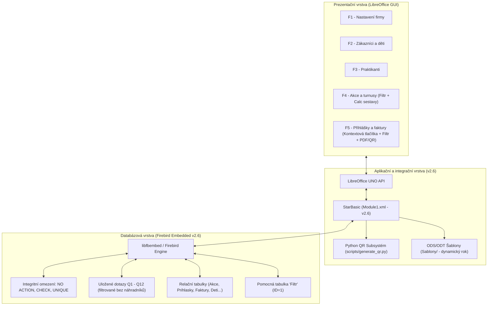

# Programátorská a administrátorská dokumentace – Šťastný statek

> **Verze dokumentu:** 2.6 (Technická a vývojářská specifikace)  
> **Datum vydání:** Listopad 2026  
> **Určeno pro:** Vývojáře databázových aplikací LibreOffice, správce systémů a systémové integrátory  
> **Technologie:** LibreOffice Base 26+ (StarBasic / UNO API), Firebird 3.0+ Embedded, Python 3.10+, ODF 1.3  
> **Umístění projektu:** `Libre_Office_Base/` a přenosový balíček `Libre_Office_Base_presun/`

---

## 1. Architektura a systémové komponenty

Systém je koncipován jako plně autonomní databázová aplikace typu **Desktop DBMS** běžící na OpenDocument standardu (ODF 1.3 / ISO 26300). Nevyžaduje instalaci samostatného databázového serveru; veškeré databázové struktury, aplikační logika a vizuální formuláře jsou zapouzdřeny v souboru `.odb`.



### Systémové závislosti a runtime požadavky
- **LibreOffice:** Verze 26.0+ (Base, Calc, Writer). Vhodné pro nativní instalace i Flatpak (`org.libreoffice.LibreOffice`).
- **Java Runtime Environment (JRE):** Volitelné pro Base Report Builder (pokud jsou sestavy editovány v grafickém návrháři).
- **Python 3:** Verze 3.10+ (používá se pro dávkové zpracování a generování QR plateb přes čistý `zlib` a `struct`).
- **Standardní POSIX nástroje:** `bash`, `zip`, `unzip` pro skript `zalohovat.sh`.

---

## 2. Vnitřní struktura kontejneru `.odb`

Soubor `Šťastný_statek.odb` (či `Stastny_statek.odb`) je komprimovaný archiv typu ZIP splňující specifikaci OASIS ODF:

```text
Šťastný_statek.odb (ZIP)
├── mimetype                             <- application/vnd.sun.xml.base
├── content.xml                          <- Definice SQL dotazů (Q1-Q12) a datových zdrojů
├── settings.xml                         <- Nastavení Base rozhraní
├── database/
│   └── firebird.fbk                     <- Binární záloha/obraz embedded Firebird 3+
├── Basic/
│   ├── script-lc.xml                    <- Registr knihoven Basicu
│   └── Standard/
│       ├── script-lb.xml                <- Registr modulů knihovny Standard
│       └── Module1.xml                  <- Kompletní zdrojový kód Basic maker (v2.6)
├── forms/
│   ├── Obj11/                          <- Formulář F1 (Nastavení firmy)
│   ├── Obj21/                          <- Formulář F2 (Zákazníci a děti)
│   ├── Obj31/                          <- Formulář F3 (Praktikanti)
│   ├── Obj41/                          <- Formulář F4 (Akce a turnusy + filtrovací lišta)
│   └── Obj51/                          <- Formulář F5 (Přihlášky a faktury + filtrovací lišta)
└── reports/
    └── Obj11/ až Obj111/                <- Tiskové sestavy systému (celkem 11 sestav)
```

---

## 3. Databázové schéma a bezpečnostní pravidla (Firebird)

Ve verzi 2.6 byla dokončena plná databázová integrita přímo v engine Firebird (`database/firebird.fbk`):

### 1. Zrušení kaskádového mazání (ochrana účetních a klientských dat)
- `FK_Fakt_Prih`: změněno z `ON DELETE CASCADE` na `ON DELETE NO ACTION`. Přihlášku s vystavenými fakturami nelze smazat.
- `FK_Prih_Akce`: změněno na `ON DELETE NO ACTION`. Akci s existujícími přihláškami nelze smazat.
- `FK_Prih_Zak`: změněno na `ON DELETE NO ACTION`. Zákazníka s přihláškami nelze smazat.

### 2. Unikátní omezení proti duplicitám faktur
```sql
ALTER TABLE "Faktury" ADD CONSTRAINT "UQ_FAKT_PRIH_TYP"
  UNIQUE ("ID_Prihlasky", "Typ_Faktury");
```
Zabraňuje vložení dvou zálohových, dvou doplatkových či dvou celkových faktur ke stejné přihlášce na úrovni databázového jádra.

### 3. Kontrolní omezení CHECK (doménová integrita)
```sql
-- Typ akce
ALTER TABLE "Akce" ADD CONSTRAINT "CHK_AKCE_TYP"
  CHECK ("Typ_Akce" IN ('LETNI_TABOR', 'DETSKY_VIKEND', 'PODZIMNI_PRAZDNINY', 'VYJIZDKA', 'BALICEK', 'BALICEK_1D', 'BALICEK_2D'));

-- Stav přihlášky
ALTER TABLE "Prihlasky" ADD CONSTRAINT "CHK_PRIH_STAV"
  CHECK ("Stav" IN ('POTVRZEN', 'NAHRADNIK', 'STORNO', 'PRIHLASEN'));

-- Typ faktury
ALTER TABLE "Faktury" ADD CONSTRAINT "CHK_FAKT_TYP"
  CHECK ("Typ_Faktury" IN ('ZALOHOVA', 'DOPLATKOVA', 'CELKOVA'));

-- Maximální délka variabilního symbolu pro QR standard SPAYD (ČNB limit 10 číslic)
ALTER TABLE "Prihlasky" ADD CONSTRAINT "CHK_PRIH_VS"
  CHECK (CHAR_LENGTH("Variabilni_Symbol") <= 10);

ALTER TABLE "Faktury" ADD CONSTRAINT "CHK_FAKT_VS"
  CHECK (CHAR_LENGTH("Variabilni_Symbol") <= 10);
```

---

## 4. Aplikační logika v modulu maker (StarBasic v2.6)

Modul `Module1.xml` obsahuje klíčové procedury pro řízení procesů:

### 1. Kontextové vystavování faktur (`VytvoritFakturuContext`)
Procedura zpracovává volání z tlačítek formuláře F5:
- **Čtení kontextu z události (`oEvent`):** Pokud uživatel stiskne tlačítko v F5, makro detekuje `oForm = oEvent.Source.Model.Parent` a načte `ID_Prihlasky` přímo z aktuálně zobrazeného záznamu. Není nutné otevírat doplňující výběrový dialog.
- **Zákaz fakturace náhradníků a stornovaných:**
  ```basic
  IF sStavPrih = "NAHRADNIK" THEN
      MsgBox "CHYBA: Přihláška ID " & nIDPrih & " je ve stavu 'NAHRADNIK'. Náhradníkům nelze vystavovat faktury před potvrzením účasti.", 16, "Chyba"
      EXIT SUB
  END IF
  ```
- **Striktní zákaz duplicitních faktur:**
  - Při pokusu o druhou zálohu: tvrdý `EXIT SUB` s chybovým hlášením.
  - Při pokusu o celkovou fakturu k přihlášce s doklady: tvrdý `EXIT SUB`.
  - Při pokusu o doplatek k plně vyfakturované přihlášce: tvrdý `EXIT SUB`.
- **Automatická aktualizace UI:** Po provedení zápisu do databáze makro zavolá `oForm.getByName("SubForm").reload()`, čímž se nově vystavená faktura ihned zobrazí v tabulce formuláře F5.

### 2. Pravidla pro splatnost doplatku
```basic
IF LEN(sDatumOd) >= 10 THEN
    dDatumOdVal = CDate(sDatumOd)
    IF dDatumOdVal - Date > 14 THEN
        sSpl = Format(dDatumOdVal - 14, "YYYY-MM-DD")
    ELSE
        sSpl = Format(Date + 14, "YYYY-MM-DD")
    END IF
END IF
```

### 3. Číslování faktur (`FAK-RRRR-NNN`)
Zjišťuje nejvyšší existující číslo v daném roce pomocí `SELECT MAX("Cislo_Faktury")` a inkrementuje pořadové číslo. Formát je jednotný: `FAK-2027-001`, `FAK-2027-002` atd.

### 4. Evidence bezinfekčnosti na konkrétní turnus (`OznacitBezinfekcnost`)
Bezinfekčnost je vztažena k přihlášce (`Prihlasky.Bezinfekcnost = 1`), nikoliv jako trvalá vlastnost dítěte z minulých let. Datum posledního odevzdání se na kartu dítěte ukládá pouze informativně.

---

## 5. Uložené SQL dotazy v `content.xml`

1. **`Q3_Seznam_Ucastniku`:** Vylučuje `STORNO` i `NAHRADNIK`.
2. **`Q4_Kooperativa`:** Vylučuje děti s úrazovým pojištěním a vylučuje `STORNO` i `NAHRADNIK`.
3. **`Q5_Bez_Bezinfekcnosti`:**
   ```sql
   WHERE COALESCE("Prihlasky"."Bezinfekcnost", 0) = 0
     AND "Prihlasky"."Stav" NOT IN ('STORNO', 'NAHRADNIK')
     AND ("Filtr"."ID_Akce" IS NULL OR "Akce"."ID_Akce" = "Filtr"."ID_Akce")
   ```
4. **`Q6_Nezaplacene_Zalohy` a `Q7_Nezaplacene_Doplatky`:** Seřazení podle data splatnosti vzestupně.
5. **`Q8_Prehled_Prijmu`:** Zahrnuje plně uhrazené faktury (`Uhrazeno = 1`) s reálnou částkou.
6. **`Q9_Rodice_Dle_Turnusu`:** Adresář rodičů potvrzených účastníků (vylučuje `STORNO` a `NAHRADNIK`).
7. **`Q10_Obsazenost_Akce`:** Výpočet volných míst odečtením aktivních přihlášek od kapacity.

---

## 6. Přehled tiskových sestav (11 sestav)

Systém disponuje 11 registrovanými sestavami:
1. `rpt_Obsazenost_Calc`
2. `rpt_Kooperativa_Calc`
3. `rpt_BezBezinfekcnosti_Calc`
4. `rpt_Nahradnici_Calc`
5. `rpt_NezaplaceneZalohy_Calc`
6. `rpt_NezaplaceneDoplatky_Calc`
7. `rpt_PrehledPrijmu_Calc`
8. `rpt_Praktikanti_Calc`
9. `rpt_Upozorneni_Rodice_Calc`
10. `rpt_SeznamUcastniku_Writer` (oficiální formátovaná nástupní listina)
11. `rpt_SeznamUcastniku_Calc` (tabulkový export účastníků do Calcu)

---

## 7. Administrátorské postupy a zálohování

### Zálohovací skript `zalohovat.sh`
- Skript vytváří ZIP archiv v adresáři `ZAL/` s časovým razítkem:
  `Zaloha_Stastny_statek_YYYY-MM-DD_hh-mm-ss.zip`.
- Aktualizuje čistou kopii do složky `ZAL/latest/`.
- Makro `ZalohovatData()` v LibreOffice po dokončení zkontroluje fyzickou existenci výsledného souboru a informuje uživatele.

### Obnova databáze
1. Ukončit veškeré procesy LibreOffice (`killall soffice.bin`).
2. Nahradit soubor `.odb` v kořenovém adresáři souborem ze složky `ZAL/latest/` nebo rozbaleného archivu.
3. Spustit aplikaci v LibreOffice Base. Veškeré vazby a data jsou okamžitě plně funkční.
