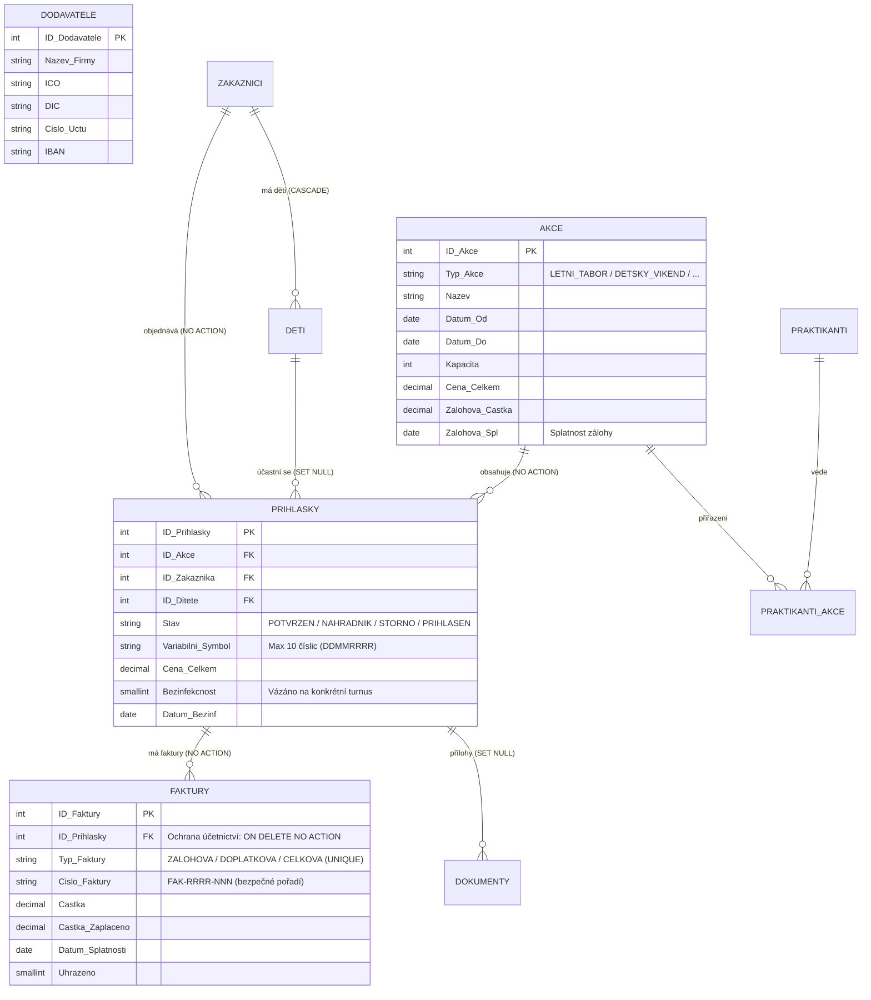

# Uživatelská dokumentace: Evidence táborů a fakturace Šťastný statek

**Verze systému:** 2.6  
**Datum vydání:** Listopad 2026  
**Platforma:** LibreOffice Base 26.2+ / Firebird 3+ (embedded)  
**Určeno pro:** Obsluhu statku, administrativní pracovníky, vedoucí táborů

---

## 1. Úvod a účel systému

Systém **Šťastný statek** představuje ucelené řešení pro evidenci dětských táborů, víkendových akcí u koní, balíčků služeb a vyjížděk. Aplikace plně zastřešuje administrativní a finanční agendu:
- Správu zákazníků (rodičů), jejich dětí a personálního obsazení (praktikantů).
- Plánování akcí a hlídání jejich kapacit.
- Příjem a správu přihlášek včetně evidence zdravotního stavu a bezinfekčnosti.
- Automatizované vystavování zálohových, doplatkových i celkových faktur.
- Generování platebních QR kódů dle bankovního standardu ČR (**SPAYD**).
- Export oficiálních nástupních listin, podkladů pro pojišťovnu a přehledů plateb do aplikací **LibreOffice Calc** a **Writer**.

---

## 2. Architektura databáze a datový model

Systém je postaven na moderním relačním SQL stroji **Firebird**, který je integrován přímo v souboru `.odb` (embedded). Data jsou uložena v 10 vzájemně provázaných tabulkách s přísnými kontrolními a referenčními pravidly:



---

## 3. Popis formulářů aplikace

Aplikace disponuje 5 formuláři navrženými pro ergonomickou a bezpečnou práci obsluhy:

### Formulář F1 – Nastavení firmy
- **Účel:** Správa údajů provozovatele statku.
- **Položky:** Název firmy, jméno provozovatele, IČO, DIČ, sídlo, kontaktní telefon, e-mail, bankovní spojení, číslo účtu a kód **IBAN**.
- **Význam pro fakturaci:** Systém přebírá tyto údaje automaticky do záhlaví faktur i přihlášek. Kód **IBAN** je klíčový pro správné sestavení platebních QR kódů.
- *Poznámka:* Systém striktně vybírá výchozí profil dodavatele (`ID_Dodavatele = 1`).

### Formulář F2 – Zákazníci a děti
- **Účel:** Evidence rodin a účastníků táborů.
- **Hlavní část (Rodič):** Jméno, příjmení, kontaktní telefon, e-mail, bydliště (ulice, město, PSČ), případně IČO/DIČ pro faktury na firmu nebo zaměstnanecké příspěvky (FKSP).
- **Podformulář (Děti rodiče):** Každý rodič může mít přiřazeno libovolné množství dětí. U každého dítěte se eviduje:
  - Datum narození (základ pro sestavení variabilního symbolu `DDMMRRRR` a věkových skupin).
  - Zdravotní pojišťovna a číslo pojištěnce.
  - Příznak **Úrazové pojištění** (při hodnotě `NE` se dítě automaticky zařazuje do sestavy pro pojišťovnu Kooperativa).
  - Zdravotní omezení (alergie, medikace, dietní požadavky).
  - Plavecké schopnosti (`PLAVEC`, `CASTECNY`, `NEPLAVEC`) a dovednosti u koní (zaznamenávané v poznámce dítěte).
  - Informativní datum posledního odevzdání potvrzení o bezinfekčnosti.

### Formulář F3 – Praktikanti
- **Účel:** Evidence táborových vedoucích, instruktorů jezdectví a zdravotníků.
- **Položky:** Jméno, příjmení, datum narození, telefon, e-mail, adresa a poznámka ke kvalifikaci či zdravotnickému kurzu.

### Formulář F4 – Akce a turnusy
- **Účel:** Správa nabídky pobytů, plánování kapacit a personálního obsazení.
- **Hlavička formuláře:**
  - Výběr typu akce (`LETNI_TABOR`, `DETSKY_VIKEND`, `PODZIMNI_PRAZDNINY`, `VYJIZDKA`, `BALICEK`, `BALICEK_1D`, `BALICEK_2D`).
  - Termín od–do, celková kapacita účastníků, celková cena a výše požadované zálohy s datem splatnosti (`Zalohova_Spl`).
- **Filtrovací lišta v záhlaví:**
  - Umožňuje jedním kliknutím vybrat konkrétní turnus.
  - Okamžitě vyfiltruje podformulář **Praktikanti na akci** – v tabulce se zobrazují pouze vedoucí přiřazení pro vybraný turnus.
  - Tlačítko **Zobrazit vše** vrátí formulář do nefiltrovaného režimu.
- **Tlačítka rychlého generování sestav Calc přímo v F4:**
  - 📊 **Obsazenost akcí (Calc):** Generuje přehled kapacity a volných míst.
  - 🛡️ **Seznam pro pojišťovnu (Calc):** Generuje seznam nepojištěných dětí pro pojišťovnu Kooperativa.
  - 🩺 **Kontrola bezinfekčnosti (Calc):** Přehled dětí, které dosud nedodaly prohlášení o bezinfekčnosti pro daný turnus.
  - *Interaktivní volba:* Dialog se vždy zeptá, zda vygenerovat sestavu **pouze pro aktuální turnus** ([ANO]), nebo **souhrnně za všechny akce** ([NE]).

### Formulář F5 – Přihlášky a faktury
- **Účel:** Centrální dispečink přihlášek dětí a fakturace.
- **Filtrovací lišta turnusů:**
  - Umožňuje filtrovat přihlášky podle zvoleného turnusu (např. *Letní tábor u koní 1 turnus*). Obsluha nemusí listovat desítkami přihlášek z jiných akcí.
- **Položky přihlášky:**
  - Provázání Akce – Rodič – Dítě.
  - Stav přihlášky (`POTVRZEN`, `PRIHLASEN`, `NAHRADNIK`, `STORNO`).
  - Variabilní symbol (standardně 8 číslic ve formátu `DDMMRRRR`) a celková cena.
  - Evidence bezinfekčnosti pro tento konkrétní pobyt (`Bezinfekcnost`).
- **Podformulář faktur:**
  - Tabulka zobrazuje všechny vystavené faktury k dané přihlášce (standardně 1× zálohová a 1× doplatková).
  - Zobrazuje číslo, částku, stav úhrady a datum zaplacení.
- **Inteligentní kontextová ovládací tlačítka v F5 (verze 2.6):**
  - Všechna tlačítka v F5 pracují **přímo s aktuálně zobrazenou přihláškou**:
  - 📄 **Tisk Přihlášky PDF:** Otevře a předvyplní přihlášku aktuálního dítěte (s dynamicky doplněným rokem turnusu).
  - 💳 **Vytvořit zálohovou fakturu:** Vystaví zálohovou fakturu k aktuální přihlášce a okamžitě obnoví tabulku faktur.
  - 💰 **Vytvořit doplatkovou fakturu:** Spočítá zbývající částku k dofakturování a vystaví doplatek.
  - 🖨️ **Tisk Faktury PDF:** Vytiskne fakturu označenou v podformuláři (nebo nabídne výběr).
  - 🩺 **Označit bezinfekčnost:** Nastaví odevzdání bezinfekčnosti pro aktuální přihlášku.

---

## 4. Fakturační pravidla a finanční bezpečnost (verze 2.6)

Ve verzi 2.6 byla implementována přísná ochrana účetních pravidel na úrovni maker i databázového jádra:

### A. Striktní zákaz duplicitních faktur
- **Záloha:** K jedné přihlášce lze vystavit **pouze jednu zálohovou fakturu**. Pokus o vystavení druhé zálohy systém striktně zablokuje s chybovým hlášením.
- **Celková faktura:** Lze vystavit pouze tehdy, pokud k přihlášce dosud neexistuje žádná faktura. Nelze kombinovat celkovou fakturu se zálohou či doplatkem.
- **Doplatek:** K jedné přihlášce lze vystavit **pouze jednu doplatkovou fakturu**. Pokud je již cena pobytu plně vyfakturována, vystavení doplatku je zablokováno.
- **Databázové jištění:** Pravidlo je chráněno nejen v makrech, ale i na úrovni databáze Firebird unikátním indexem `UQ_FAKT_PRIH_TYP` na dvojici sloupců `(ID_Prihlasky, Typ_Faktury)`.

### B. Zákaz fakturace náhradníků
- Přihlášky ve stavu `NAHRADNIK` a `STORNO` **nelze fakturovat**.
- Tlačítka pro vystavení faktury operaci okamžitě odmítnou. Teprve po potvrzení účasti dítěte (změna stavu na `POTVRZEN`) je vystavení dokladu povoleno.

### C. Zbývající částka k vyfakturování vs. skutečný dluh klienta
- **Částka doplatkové faktury:**
  $$\text{Doplatek} = \text{Cena pobytu} - \sum(\text{Vystavené faktury})$$
  Tato hodnota představuje *zbývající částku k dofakturování*.
- **Skutečný dluh klienta:**
  $$\text{Dluh} = \text{Cena pobytu} - \sum(\text{Skutečně zaplacené částky})$$
  Pokud rodič dosud nezaplatil vystavenou zálohu, jeho reálný nedoplatek je vyšší než částka na doplatkové faktuře. Sestavy nezaplacených záloh a doplatků sledují tyto stavy samostatně.

### D. Pravidla pro stanovení splatnosti
- **Zálohová faktura:** Přebírá datum `Zalohova_Spl` zadané ve formuláři F4 u dané akce. Pokud není zadáno, použije se výchozí lhůta 14 dnů od vystavení.
- **Doplatková faktura:**
  - Pokud do začátku akce zbývá **více než 14 dní**, nastaví se splatnost na **14 dní před začátkem akce** (standardní storno limit táborů).
  - Pokud do začátku akce zbývá **méně než 14 dní** (nebo akce již začala), nastaví se splatnost na **14 dní ode dne vystavení faktury**.

### E. Ochrana před smazáním daňových dokladů (NO ACTION)
- Cizí klíč `FK_Fakt_Prih` má nastaveno pravidlo `ON DELETE NO ACTION`.
- Databáze **nedovolí smazat přihlášku, ke které již existují vystavené faktury**.
- Obdobně vazby `Prihlasky -> Akce` a `Prihlasky -> Zakaznici` zabraňují nechtěnému smazání akce či rodiče, pokud mají aktivní přihlášky s doklady. Účetní a daňová historie je tak 100% chráněna.

---

## 5. Standard QR plateb (SPAYD) a variabilní symboly

Všechny faktury statku obsahují QR kód dle oficiálního standardu České bankovní asociace (**SPAYD – Short Payment Descriptor**).

```text
SPD*1.0*ACC:CZ6508000000001652608083*AM:2000.00*CC:CZK*X-VS:15032027*MSG:FAK-2027-001 Novak
```

### Pravidla pro Variabilní symbol (VS):
- Dle specifikace ČNB a SPAYD smí mít parametr `X-VS` **maximálně 10 číslic** (databáze Firebird toto pravidlo hlídá pomocí `CHECK (CHAR_LENGTH("Variabilni_Symbol") <= 10)`).
- Systém Šťastný statek používá standardní 8místný formát:
  $$\text{DDMM} \text{ (den a měsíc narození dítěte)} + \text{RRRR} \text{ (rok turnusu)}$$
  *Příklad:* Dítě narozené 15. března, turnus v roce 2027 $\rightarrow$ VS: **`15032027`**.
- U dospělých osob bez data narození dítěte se používá formát `0001RRRR`, `0002RRRR` atd.

---

## 6. Provozní návody krok za krokem

### Návod 1: Vytvoření nového turnusu tábora
1. Otevřete formulář **F4 – Akce a turnusy**.
2. Na navigační liště dole klikněte na tlačítko **Nový záznam** (*Hvězdička*).
3. Vyberte typ akce `LETNI_TABOR`, zadejte název (např. *Letní tábor u koní 1 turnus*).
4. Nastavte termín od–do (např. `27.06.2027` – `02.07.2027`).
5. Zadejte kapacitu dětí (např. `20`), celkovou cenu (např. `5 500,00 Kč`), zálohu (např. `2 000,00 Kč`) a termín splatnosti zálohy (např. `15.05.2027`).
6. Uložte záznam stiskem ikony diskety.
7. V podformuláři **Praktikanti na akci** přiřaďte vedoucí výběrem ze seznamu.

### Návod 2: Zápis přihlášky dítěte
1. Ve formuláři **F2** zadejte rodiče a dítě (jméno, datum narození, pojišťovna).
2. Otevřete formulář **F5 – Přihlášky a faktury** a klikněte na **Nový záznam**.
3. Vyberte Akci, Rodiče a Dítě.
4. Do pole **Variabilní symbol** zadejte 8 číslic `DDMMRRRR` (např. `15032027`).
5. Nastavte stav na `POTVRZEN` (pro řádného účastníka) nebo `NAHRADNIK`. Uložte přihlášku.
6. Kliknutím na **📄 Tisk Přihlášky PDF** přímo vygenerujete závaznou přihlášku pro rodiče.

### Návod 3: Vystavení zálohy a doplatku
1. Ve formuláři **F5** najděte přihlášku potvrzeného dítěte.
2. Klikněte na **💳 Vytvořit zálohovou fakturu**. Systém vystaví zálohu (např. `FAK-2027-001`) a ihned ji zobrazí v tabulce faktur dole.
3. Přibližně 30 dní před nástupem klikněte na **💰 Vytvořit doplatkovou fakturu**. Systém dopočítá doplatek (např. 3 500 Kč) a nastaví splatnost 14 dní před zahájením tábora.
4. Kliknutím na **🖨️ Tisk Faktury PDF** otevřete doklad v Calcu s vygenerovaným platebním QR kódem.

### Návod 4: Zaevidování platby a kontrola bezinfekčnosti
1. Po připsání platby na účet najděte fakturu ve formuláři **F5**.
2. Nastavte pole **Uhrazeno** na `1`, vyplňte **Datum_Zaplaceno** a zadejte **Castka_Zaplaceno**. Záznam uložte.
3. Při nástupu na tábor obsluha zkontroluje lékařský posudek a bezinfekčnost:
   - Stiskem tlačítka **🩺 Označit bezinfekčnost** ve formuláři F5 se bezinfekčnost pro tento turnus zaeviduje.
   - Sestava `rpt_BezBezinfekcnosti_Calc` ihned dítě vyřadí ze seznamu chybějících dokumentů.

---

## 7. Přehled tiskových sestav a jejich filtrů

V aplikaci je k dispozici celkem **11 tiskových sestav**:

| Název sestavy | Formát | Co přesně vybírá a jaké stavy zahrnuje |
| :--- | :--- | :--- |
| `rpt_Obsazenost_Calc` | Calc | Kapacita akce, počet potvrzených přihlášených dětí a volná místa (vylučuje `STORNO` a `NAHRADNIK`). |
| `rpt_Kooperativa_Calc` | Calc | Seznam dětí bez vlastního úrazového pojištění pro hromadné pojištění Kooperativa (vylučuje `STORNO` i `NAHRADNIK`). |
| `rpt_BezBezinfekcnosti_Calc`| Calc | Seznam dětí, které pro daný turnus dosud neodevzdaly bezinfekčnost (`Prihlasky.Bezinfekcnost = 0`, vylučuje `STORNO` a `NAHRADNIK`). |
| `rpt_Nahradnici_Calc` | Calc | Přehled dětí ve stavu `NAHRADNIK` seřazený dle data podání přihlášky pro rychlé doplnění uvolněných míst. |
| `rpt_NezaplaceneZalohy_Calc`| Calc | Seznam všech neuhrazených zálohových faktur seřazený vzestupně podle data splatnosti (nejurgentnější nahoře). |
| `rpt_NezaplaceneDoplatky_Calc`| Calc | Seznam všech neuhrazených doplatkových faktur před nástupem na tábor. |
| `rpt_PrehledPrijmu_Calc` | Calc | Souhrnný přehled plně uhrazených faktur (`Uhrazeno = 1`) se skutečně zaplacenou částkou. |
| `rpt_Praktikanti_Calc` | Calc | Personální přehled obsazení jednotlivých akcí vedoucími a instruktory. |
| `rpt_Upozorneni_Rodice_Calc`| Calc | Telefonní a e-mailový adresář rodičů potvrzených účastníků pro předtáborovou organizační komunikaci. |
| `rpt_SeznamUcastniku_Writer`| Writer | Formátovaná nástupní listina účastníků s daty narození pro vedoucího turnusu k fyzickému odškrtávání dětí. |
| `rpt_SeznamUcastniku_Calc` | Calc | Datový export seznamu potvrzených účastníků turnusu do tabulkového procesoru pro další analýzy a filtry. |

---

## 8. Zálohování celého systému a obnova dat

### Automatizované zálohování (`zalohovat.sh`)
- Skript je připraven v kořenovém adresáři projektu. Lze jej spustit z terminálu `./zalohovat.sh` nebo stiskem tlačítka v aplikaci.
- **Co skript vykoná:**
  1. Zkontroluje konzistenci a přítomnost hlavní databáze `Stastny_statek.odb` / `Šťastný_statek.odb`.
  2. Vytvoří časově orazítkovaný ZIP archiv v adresáři `ZAL/` (obsahuje databázi, šablony, vygenerované doklady i SQL schémata).
  3. Uloží přímou kopii aktuálního souboru databáze do `ZAL/latest/`.
  4. Makro v aplikaci po dokončení ověří vznik souboru a zobrazí potvrzení.

### Postup obnovy databáze ze zálohy
1. Ukončete všechny běžící procesy LibreOffice.
2. Přejděte do složky `ZAL/latest/` (nebo rozbalte ZIP archiv z `ZAL/`).
3. Zkopírujte soubor `Stastny_statek.odb` (či `Šťastný_statek.odb`) zpět do hlavní složky projektu.
4. Znovu otevřete aplikaci v LibreOffice. Veškerá data jsou obnovena do stavu v okamžiku vytvoření zálohy.
