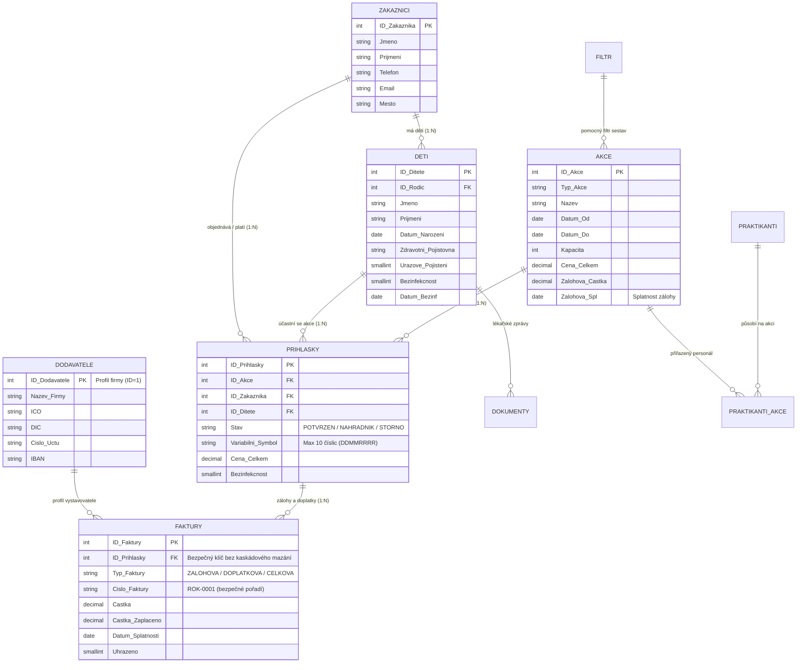

# Uživatelská dokumentace – Evidenční a fakturační systém Šťastný statek

> **Verze systému:** 2.5 (2026/2027)  
> **Platforma:** LibreOffice Base 26+ / Vestavěná relační databáze Firebird 3 (embedded)  
> **Organizace:** Šťastný statek (Luděk Šťastný, Provodín 211, IČO: 74461028)  
> **Oficiální web:** [www.stastnystatek.cz](https://www.stastnystatek.cz)

---

## 1. Úvod a účel systému

Systém **Šťastný statek** představuje ucelené řešení pro komplexní evidenci a fakturaci aktivit v oblasti agroturistiky, chovu koní a pobytových akcí. Aplikace plně pokrývá dva hlavní provozní toky:

1. **Vyjížďky na koních a pobytové balíčky:**
   - Individuální a skupinové vyjížďky pro dospělé i rodiny.
   - Víkendové a vícedenní pobytové balíčky u koní.
   - Přímá fakturace zákazníkovi bez nutnosti generování složitých táborových přihlášek.

2. **Dětské pobytové akce:**
   - **Letní tábory u koní** (`LETNI_TABOR`) – týdenní pobytové turnusy.
   - **Dětské víkendy u koní** (`DETSKY_VIKEND`) – víkendové pobyty pro děti.
   - **Podzimní prázdniny** (`PODZIMNI_PRAZDNINY`) – tematické pobytové turnusy.
   - Kompletní agenda: přihláška dítěte s vazbou na zákonného zástupce, zdravotní způsobilost a bezinfekčnost, přiřazení 2–3 praktikantů na turnus, sledování kapacity a automatické vystavení zálohové i doplatkové faktury s **českým QR platebním kódem (SPAYD)**.

---

## 2. Architektura a datový model

Aplikace je postavena na souborovém databázovém systému **LibreOffice Base** s moderním vestavěným relačním enginem **Firebird 3 (embedded)**. Všechna data jsou uložena v jediném souboru `Šťastný_statek.odb` (či `Stastny_statek.odb`), což eliminuje nutnost instalace a konfigurace externích databázových serverů (MySQL, PostgreSQL).

### Diagram datového modelu (ERD)



---

## 3. Popis formulářů aplikace

Aplikace disponuje 5 formuláři navrženými pro přehlednou práci obsluhy:

### Formulář F1 – Nastavení firmy
- **Účel:** Správa údajů provozovatele statku.
- **Položky:** Název firmy, jméno provozovatele, IČO, DIČ, sídlo, kontaktní telefon, e-mail, bankovní spojení, číslo účtu a kód **IBAN**.
- **Význam pro fakturaci:** Systém přebírá tyto údaje automaticky do záhlaví faktur i přihlášek. Kód **IBAN** je klíčový pro správné sestavení platebních QR kódů.
- *Upozornění:* Tabulka předpokládá jeden hlavní záznam vystavovatele (ID=1).

### Formulář F2 – Zákazníci a děti
- **Účel:** Evidence rodin a účastníků táborů.
- **Hlavní část (Rodič):** Jméno, příjmení, kontaktní telefon, e-mail, bydliště (ulice, město, PSČ), případně IČO/DIČ pro faktury na firmu nebo zaměstnanecké příspěvky (FKSP).
- **Podformulář (Děti rodiče):** Každý rodič může mít přiřazeno libovolné množství dětí. U každého dítěte se eviduje:
  - Datum narození (důležité pro sestavení variabilního symbolu a věkových skupin).
  - Zdravotní pojišťovna a číslo pojištěnce.
  - Příznak **Úrazové pojištění** (při hodnotě `NE` se dítě automaticky zařazuje do sestavy pro pojišťovnu Kooperativa).
  - Zdravotní omezení (alergie, medikace, dietní požadavky).
  - Plavecké schopnosti a dovednosti u koní.
  - Příznak a datum potvrzení o **bezinfekčnosti**.

### Formulář F3 – Praktikanti
- **Účel:** Evidence táborových vedoucích, instruktorů jezdectví a zdravotníků.
- **Položky:** Jméno, příjmení, datum narození, telefon, e-mail, adresa a poznámka ke kvalifikaci či zdravotnickému kurzu.

### Formulář F4 – Akce a turnusy
- **Účel:** Správa nabídky pobytů, plánování kapacit a personálního obsazení.
- **Hlavička formuláře:**
  - Výběr typu akce (`LETNI_TABOR`, `DETSKY_VIKEND`, `PODZIMNI_PRAZDNINY`, `VYJIZDKA`, `BALICEK`).
  - Termín od–do, celková kapacita účastníků, celková cena a výše požadované zálohy s datem splatnosti (`Zalohova_Spl`).
- **Filtrovací lišta v záhlaví:**
  - Umožňuje jedním kliknutím vybrat konkrétní turnus.
  - Okamžitě vyfiltruje podformulář **Praktikanti na akci** – v tabulce se zobrazují pouze vedoucí přiřazení pro vybraný turnus.
  - Tlačítko **Zobrazit vše** vrátí formulář do nefiltrovaného režimu.
- **Tlačítka rychlého generování sestav Calc přímo v F4:**
  - 📊 **Obsazenost akcí (Calc):** Generuje přehled kapacity a volných míst.
  - 🛡️ **Seznam pro pojišťovnu (Calc):** Generuje seznam nepojištěných dětí pro pojišťovnu Kooperativa.
  - 🩺 **Kontrola bezinfekčnosti (Calc):** Přehled dětí, které dosud nedodaly prohlášení o bezinfekčnosti.
  - *Interaktivní volba:* Dialog se vždy zeptá, zda vygenerovat sestavu **pouze pro aktuální turnus** ([ANO]), nebo **souhrnně za všechny akce** ([NE]).

### Formulář F5 – Přihlášky a faktury
- **Účel:** Centrální dispečink přihlášek dětí a fakturace.
- **Filtrovací lišta turnusů:**
  - Umožňuje filtrovat přihlášky podle zvoleného turnusu (např. *Letní tábor u koní 1 turnus*). Obsluha nemusí listovat desítkami přihlášek z jiných akcí.
- **Položky přihlášky:**
  - Provázání Akce – Rodič – Dítě.
  - Stav přihlášky (`POTVRZEN`, `PRIHLASEN`, `NAHRADNIK`, `STORNO`).
  - Variabilní symbol (standardně 8 číslic ve formátu `DDMMRRRR`) a celková cena.
- **Podformulář faktur:**
  - Tabulka zobrazuje všechny vystavené faktury k dané přihlášce (typicky 1× zálohová a 1× doplatková).
  - U každé faktury je zobrazeno číslo, částka, stav úhrady a datum zaplacení.
- **Ovládací tlačítka v F5:**
  - 📄 **Tisk Přihlášky PDF:** Otevře a předvyplní oficiální přihlášku dle šablony turnusu.
  - 💳 **Vytvořit zálohovou fakturu:** Vystaví novou zálohovou fakturu dle nastavené zálohy turnusu.
  - 💰 **Vytvořit doplatkovou fakturu:** Vypočítá zbývající částku (Cena celkem − dosud vyfakturováno) a vystaví doplatek.
  - 🖨️ **Tisk Faktury PDF:** Otevře vybranou fakturu v tabulce Calc, dynamicky vygeneruje a vloží **QR platbu (SPAYD)** a připraví fakturu k tisku či exportu do PDF.

---

## 4. Fakturační pravidla a bezpečnostní ochrana (verze 2.5)

V nové verzi systému byla implementována přísná kontrolní pravidla zamezující vzniku chyb v účetnictví:

### A. Ochrana proti duplicitním fakturám
Při stisku tlačítka pro vytvoření zálohové nebo doplatkové faktury systém nejprve prohledá stávající faktury dané přihlášky:
- Pokud již zálohová faktura pro dané dítě existuje, makro zobrazí varovné okno:
  > *"UPOZORNĚNÍ: Pro tuto přihlášku již existuje zálohová faktura č. 2026-0005 (vyfakturováno celkem: 3 000,00 Kč). Přejete si přesto vystavit další zálohovou fakturu?"*
- Obsluha může operaci bezpečně zrušit ([NE]), čímž se předejde omylům při opakovaném kliknutí.

### B. Inteligentní výpočet doplatku
Výpočet částky doplatkové faktury již není fixní odečet, ale vychází z reálného finančního stavu:
$$\text{Doplatek} = \text{Cena přihlášky} - \sum(\text{Dosud vyfakturované částky})$$
Pokud je již celá cena přihlášky pokryta předchozími fakturami, systém obsluhu upozorní, že zbývá k doplatku 0 Kč.

### C. Respektování termínů splatnosti z formuláře F4
- **Zálohová faktura:** Pokud je u dané akce v F4 vyplněno datum `Zalohova_Spl` (např. 31. května před táborem), faktura automaticky přebírá toto datum. Pokud vyplněno není, použije se výchozí lhůta 14 dnů.
- **Doplatková faktura:** Automaticky se nastavuje na **14 dní před začátkem akce** (pokud termín akce ještě nenastal), což odpovídá standardním táborovým storno podmínkám.

### D. Bezpečné číslování faktur
Číslování faktur v novém roce (např. `2026-0001`, `2026-0002`...) nevychází z prostého počtu záznamů `COUNT(*)`, ale zjišťuje skutečné nejvyšší vystavené číslo v daném roce. Případné smazání či stornování chybného záznamu tak nikdy nezpůsobí kolizi čísel.

### E. Ochrana před kaskádovým smazáním daňových dokladů
V databázovém schématu byl cizí klíč `Faktury -> Prihlasky` upraven tak, aby smazáním přihlášky nebo akce **nedošlo k automatickému smazání faktur**. Databáze takovou operaci odmítne a chrání účetní historii.

---

## 5. Standard QR plateb (SPAYD) a variabilní symboly

Všechny faktury statku obsahují QR kód dle standardu České bankovní asociace (**SPAYD – Short Payment Descriptor**).

```text
SPD*1.0*ACC:CZ6508000000001234567890*AM:3000.00*CC:CZK*X-VS:22042026*MSG:2026-0005 Batelkova
```

### Pravidla pro Variabilní symbol (VS):
- Dle specifikace České národní banky a formátu SPAYD smí mít parametr `X-VS` **maximálně 10 číslic**.
- V systému Šťastný statek se používá standardní 8místný formát:
  $$\text{DDMM} \text{ (den a měsíc narození)} + \text{RRRR} \text{ (rok turnusu)}$$
  *Příklad:* Dítě narozené 22. 4., tábor v roce 2026 $\rightarrow$ variabilní symbol: **`22042026`**.
- Tento symbol je vytištěn na faktuře a zakódován v QR platbě naprosto shodně, což zajišťuje bezchybné automatické párování plateb v bance.

---

## 6. Provozní návody krok za krokem

### Návod 1: Vytvoření nové táborové akce
1. Otevřete formulář **F4 – Akce a turnusy**.
2. Na navigační liště dole klikněte na tlačítko **Nový záznam** (*Hvězdička*).
3. Vyplňte typ akce (např. `LETNI_TABOR`), název (např. *Letní tábor u koní 1 turnus*).
4. Nastavte termín od–do (např. `27.06.2027` – `02.07.2027`).
5. Zadejte kapacitu dětí (např. `5`), celkovou cenu (např. `5 500,00 Kč`), požadovanou zálohu (např. `2 000,00 Kč`) a termín splatnosti zálohy (např. `15.05.2027`).
6. Uložte záznam stiskem ikony diskety.
7. V podformuláři **Praktikanti na akci** přiřaďte 2–3 vedoucí výběrem ze seznamu.

### Návod 2: Zápis nového táborníka a přihlášky
1. Otevřete formulář **F2 – Zákazníci a děti**.
2. Založte nového rodiče (jméno, příjmení, telefon, e-mail, adresa bydliště).
3. V podformuláři dětí zadejte dítě: jméno, příjmení, datum narození, pojišťovnu a zdravotní omezení. Záznam uložte.
4. Přejděte do formuláře **F5 – Přihlášky a faktury** a klikněte na **Nový záznam**.
5. Z rozevíracích seznamů vyberte příslušnou **Akci**, **Rodiče** a **Dítě**.
6. Do pole **Variabilní symbol** zadejte `DDMMRRRR` (např. datum narození 14. 5. + rok 2027 = `14052027`).
7. Nastavte stav přihlášky na `POTVRZEN` a celkovou cenu. Uložte přihlášku.

### Návod 3: Vystavení zálohy a odeslání rodičům
1. Ve formuláři **F5** vyhledejte přihlášku dítěte (nebo použijte filtrovací lištu turnusů).
2. Klikněte na modré tlačítko **💳 Vytvořit zálohovou fakturu**.
3. Zkontrolujte navrženou částku zálohy a potvrďte.
4. Systém vytvoří fakturu, nastaví splatnost a nabídne její otevření.
5. V otevřené tabulce Calc zkontrolujte údaje a přítomnost QR kódu.
6. Zvolte **Soubor $\rightarrow$ Exportovat jako $\rightarrow$ Exportovat do PDF** a uložte fakturu do `Dokumenty/Faktury/`.

### Návod 4: Úhrada a kontrola před nástupem
1. Po připsání platby na bankovní účet vyhledejte fakturu v podformuláři **F5**.
2. Zaškrtněte pole **Uhrazeno** a vyplňte datum zaplacení.
3. Přibližně 30 dní před nástupem klikněte na tlačítko **💰 Vytvořit doplatkovou fakturu**. Systém automaticky spočítá doplatek (např. 3 500 Kč) a nastaví splatnost 14 dní před táborem.
4. V den nástupu na tábor obsluha zkontroluje potvrzení o bezinfekčnosti:
   - Ve formuláři F2 nebo pomocí tlačítka označí bezinfekčnost jako odevzdanou.
   - Sestava `rpt_BezBezinfekcnosti_Calc` ihned vyřadí dítě ze seznamu dlužníků dokumentace.

---

## 7. Přehled tiskových sestav a jejich filtrů

| Název sestavy | Formát | Co přesně vybírá a kontroluje |
| :--- | :--- | :--- |
| `rpt_Obsazenost_Calc` | Calc | Kapacita akce, počet potvrzených přihlášených dětí a volná místa (vylučuje `STORNO` a `NAHRADNIK`). |
| `rpt_Kooperativa_Calc` | Calc | Seznam dětí bez úrazového pojištění pro pojišťovnu Kooperativa (vylučuje storna a náhradníky). |
| `rpt_BezBezinfekcnosti_Calc`| Calc | Seznam dětí bez odevzdané bezinfekčnosti (kontroluje záznam v přihlášce i na kartě dítěte). |
| `rpt_Nahradnici_Calc` | Calc | Seznam dětí ve stavu `NAHRADNIK` seřazený dle data podání přihlášky. |
| `rpt_NezaplaceneZalohy_Calc`| Calc | Seznam všech neuhrazených záloh seřazený vzestupně podle data splatnosti (faktury po splatnosti nahoře). |
| `rpt_NezaplaceneDoplatky_Calc`| Calc | Seznam všech neuhrazených doplatků seřazený podle data splatnosti. |
| `rpt_PrehledPrijmu_Calc` | Calc | Celkový přehled uhrazených faktur se skutečně zaplacenou částkou a datem úhrady. |
| `rpt_Praktikanti_Calc` | Calc | Personální přehled obsazení jednotlivých akcí praktikanty a vedoucími. |
| `rpt_Upozorneni_Rodice_Calc`| Calc | Telefonní a e-mailový adresář rodičů potvrzených účastníků pro předtáborovou komunikaci. |
| `rpt_SeznamUcastniku_Writer`| Writer | Oficiální nástupní listina účastníků s daty narození pro vedoucího turnusu. |

---

## 8. Zálohování celého systému a obnova dat

### Pravidelné zálohování
Projekt obsahuje automatizovaný zálohovací skript `zalohovat.sh`.
- **Spuštění z terminálu:**
  ```bash
  cd /cesta/k/projektu
  ./zalohovat.sh
  ```
- **Co skript vykoná:**
  1. Zkontroluje konzistenci a přítomnost hlavní databáze.
  2. Vytvoří kompletní časově orazítkovaný ZIP archiv v adresáři `ZAL/` (obsahuje databázi, šablony Calc/Writer, vygenerované dokumenty a SQL schémata).
  3. Uloží přímou kopii do složky `ZAL/latest/`.

### Postup obnovy databáze ze zálohy
Pokud dojde k poškození souboru nebo chybnému smazání dat:
1. Zavřete všechny moduly LibreOffice (Base, Calc, Writer).
2. Přejděte do složky `ZAL/latest/` nebo rozbalte požadovaný archiv ze složky `ZAL/`.
3. Zkopírujte soubor `Šťastný_statek.odb` (či `Stastny_statek.odb`) zpět do hlavní složky projektu.
4. Znovu otevřete aplikaci v LibreOffice. Všechna data jsou obnovena do stavu v okamžiku vytvoření zálohy.
