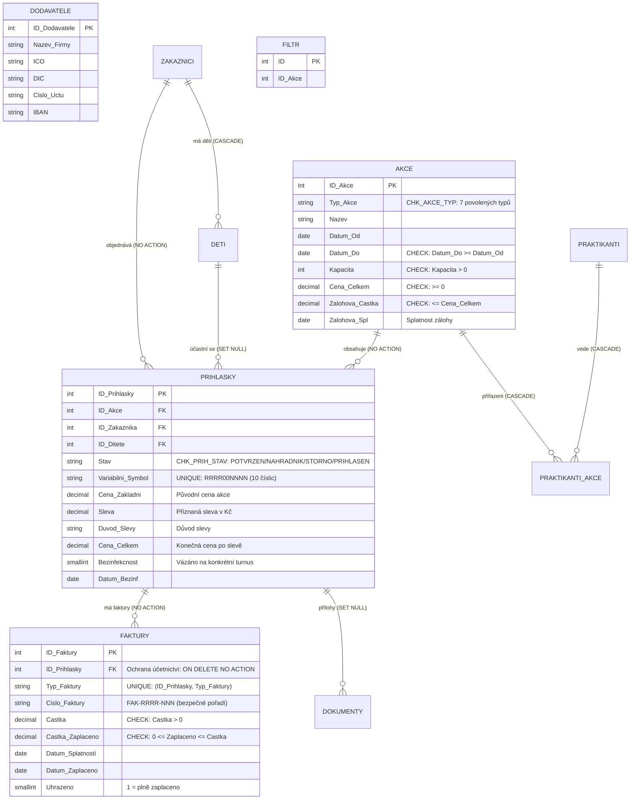

# Uživatelská dokumentace: Evidence táborů a fakturace Šťastný statek

**Verze systému:** 2.7  
**Datum vydání:** Listopad 2026  
**Platforma:** LibreOffice Base 26.2+ / Firebird 3+ (embedded)  
**Určeno pro:** Obsluhu statku, administrativní pracovníky, vedoucí táborů

---

## 1. Úvod a účel systému

Systém **Šťastný statek** představuje ucelené řešení pro evidenci dětských táborů, víkendových akcí u koní, balíčků služeb a vyjížděk. Aplikace plně zastřešuje administrativní a finanční agendu:
- Správu zákazníků (rodičů), jejich dětí a personálního obsazení (praktikantů).
- Plánování akcí a hlídání jejich kapacit a termínů.
- Příjem a správu přihlášek včetně ochrany proti duplicitním registracím téhož dítěte na stejnou akci.
- Evidenci zdravotního stavu, medikace a bezinfekčnosti přímo na kartě přihlášky konkrétního turnusu.
- Automatizované vystavování zálohových, doplatkových i celkových faktur s přísnou kontrolou návaznosti a nepřekročení ceny objednávky.
- Správu slev (např. 200 Kč pro stávajícího zákazníka) uložených přímo v databázi, které jsou 100% synchronizované s fakturami.
- Generování platebních QR kódů dle bankovního standardu České bankovní asociace (**SPAYD**) s jednoznačnými desetimístnými variabilními symboly.
- Export oficiálních nástupních listin, podkladů pro pojišťovnu a přehledů plateb do aplikací **LibreOffice Calc** a **Writer**.

---

## 2. Architektura databáze a datový model (verze 2.7)

Systém je postaven na moderním relačním SQL stroji **Firebird 3.0**, který je integrován přímo v souboru `.odb` (embedded). Všechny tabulky mají definovány přísné integritní kontroly (`CHECK`), unikátní indexy (`UNIQUE`), bezpečné mazací vazby (`ON DELETE NO ACTION`) a databázové triggery:



### Databázové triggery ve Firebirdu
1. **`TRG_CHECK_FAKTURY` (na tabulce Faktury):**
   - Striktně blokuje vystavení zálohy, pokud již byl vystaven doplatek.
   - Striktně blokuje vystavení celkové faktury, pokud již existuje záloha nebo doplatek.
   - Striktně blokuje vystavení doplatku, pokud již existuje celková faktura.
   - Vynucuje, aby součet všech faktur vystavených k dané přihlášce nepřekročil její konečnou cenu (`Prihlasky.Cena_Celkem`).
   - Kontroluje, že částka faktury je vždy kladná (`Castka > 0`).
   - Při nastavení `Uhrazeno = 1` automaticky doplní `Datum_Zaplaceno` na dnešní datum (pokud nebylo zadáno) a srovná `Castka_Zaplaceno = Castka`.
2. **`TRG_CHECK_PRIHLASKY` (na tabulce Prihlasky):**
   - Vynucuje pravidlo, že jedno dítě může mít na danou akci maximálně **jednu aktivní přihlášku** (pokud stav není `STORNO`). Pokus o duplicitní registraci databáze odmítne chybovou výjimkou.

---

## 3. Popis formulářů aplikace

Aplikace disponuje 5 ergonomickými formuláři:

### Formulář F1 – Nastavení firmy
- **Účel:** Správa údajů provozovatele statku.
- **Položky:** Název firmy, jméno provozovatele, IČO, DIČ, sídlo, telefon, e-mail, bankovní spojení, číslo účtu a kód **IBAN**.
- **Význam:** Tyto údaje se tisknou do záhlaví přihlášek i faktur. Kód **IBAN** je automaticky normalizován a použit pro generování QR kódů.
- *Poznámka:* Systém striktně vybírá výchozí profil dodavatele (`ID_Dodavatele = 1`).

### Formulář F2 – Zákazníci a děti
- **Účel:** Evidence rodin a dětí.
- **Hlavní část (Rodič):** Jméno, příjmení, telefon, e-mail, adresa, případně IČO/DIČ pro fakturaci na firmu či FKSP.
- **Podformulář (Děti rodiče):**
  - Datum narození.
  - Zdravotní pojišťovna a číslo pojištěnce.
  - Příznak **Úrazové pojištění** (při hodnotě `NE` se dítě automaticky zahrnuje do pojištění Kooperativa).
  - Zdravotní omezení (alergie, léky, diety).
  - Plavecké schopnosti (`PLAVEC`, `CASTECNY`, `NEPLAVEC`).
  - Informativní datum posledního odevzdání bezinfekčnosti.

### Formulář F3 – Praktikanti
- **Účel:** Evidence táborových vedoucích, instruktorů a zdravotníků.
- **Položky:** Jméno, příjmení, datum narození, telefon, e-mail, adresa a odborná kvalifikace.

### Formulář F4 – Akce a turnusy
- **Účel:** Správa nabídky pobytů a kapacit.
- **Hlavička formuláře:** Typ akce (`LETNI_TABOR`, `DETSKY_VIKEND`, `PODZIMNI_PRAZDNINY`, `VYJIZDKA`, `BALICEK`, `BALICEK_1D`, `BALICEK_2D`), termín od–do, kapacita, cena pobytu, záloha a její splatnost (`Zalohova_Spl`).
- **Filtrovací lišta:** Umožňuje filtrovat přiřazené praktikanty pro konkrétní turnus.
- **Tlačítka rychlých sestav:**
  - 📊 **Obsazenost akcí (Calc)**
  - 🛡️ **Seznam pro pojišťovnu (Calc)**
  - 🩺 **Kontrola bezinfekčnosti (Calc)**

### Formulář F5 – Přihlášky a faktury (Centrální dispečink)
- **Filtrovací lišta turnusů:** Filtruje přihlášky podle zvoleného turnusu.
- **Karta přihlášky:** Vazba Akce – Rodič – Dítě, stav (`POTVRZEN`, `PRIHLASEN`, `NAHRADNIK`, `STORNO`), variabilní symbol, základní cena, sleva a konečná cena.
- **Podformulář faktur:** Zobrazuje všechny vystavené faktury, stav úhrady a datum zaplacení.
- **Ovládací tlačítka (všechna pracují přímo s vybranou přihláškou):**
  - 📄 **Tisk Přihlášky PDF:** Otevře a předvyplní přihlášku ve Writeru s dynamickým rokem a zohledněním slevy.
  - 💳 **Vytvořit zálohovou fakturu:** Vystaví zálohovou fakturu a okamžitě ji zobrazí v podformuláři.
  - 💰 **Vytvořit doplatkovou fakturu:** Spočítá zbývající částku k dofakturování a vystaví doplatek.
  - 🖨️ **Tisk Faktury PDF:** Otevře vybranou fakturu v Calcu s platebním QR kódem.
  - 🩺 **Označit bezinfekčnost:** Nastaví odevzdání bezinfekčnosti pro aktuální přihlášku (`Prihlasky.Bezinfekcnost = 1`, `Datum_Bezinf = Dnes`) a automaticky obnoví formulář.

---

## 4. Fakturační pravidla a finanční bezpečnost (verze 2.7)

Ve verzi 2.7 jsou finanční pravidla chráněna na dvou úrovních: **makry v rozhraní** a **triggery přímo ve Firebirdu**:

### A. Tři základní finanční veličiny
Pro naprostou transparentnost systém rozlišuje:
1. **Cena objednávky:** Konečná cena pobytu po případné slevě (`Prihlasky.Cena_Celkem = Cena_Zakladni - Sleva`).
2. **Vyfakturováno:** Součet částek všech vystavených faktur k dané přihlášce.
3. **Zaplaceno:** Součet skutečně přijatých plateb (`Castka_Zaplaceno`).

Z těchto veličin systém odvozuje:
$$\text{K dofakturování} = \text{Cena objednávky} - \text{Vyfakturováno}$$
$$\text{Skutečný dluh klienta} = \text{Vyfakturováno} - \text{Zaplaceno}$$

### B. Pravidla posloupnosti faktur
- **Záloha:** K přihlášce lze vystavit maximálně 1 zálohovou fakturu. Nelze ji vystavit po doplatku ani po celkové faktuře.
- **Doplatek:** Vystavuje se na zbývající částku `K dofakturování`. Pokud je celá částka již vyfakturována, vystavení je zablokováno. Nelze vystavit po celkové faktuře.
- **Celková faktura:** Určena pro jednorázovou platbu (vyjížďky, balíčky nebo tábory bez zálohy). Lze vystavit pouze tehdy, pokud dosud neexistuje žádná záloha ani doplatek.
- **Zákaz překročení ceny:** Žádná faktura ani kombinace faktur nesmí překročit celkovou cenu přihlášky.

### C. Zákaz fakturace náhradníků a stornovaných přihlášek
- U přihlášek ve stavu `NAHRADNIK` a `STORNO` je vystavení jakékoliv faktury striktně zakázáno. Teprve po změně stavu na `POTVRZEN` je fakturace povolena.

### D. Evidence slev přímo v databázi
- Pokud dítě v minulosti absolvovalo táborovou akci statku, má nárok na slevu 200 Kč na letní tábor.
- Sleva se nově ukládá přímo do databáze:
  - `Prihlasky.Cena_Zakladni` = původní cena akce (např. 5 500 Kč)
  - `Prihlasky.Sleva` = 200 Kč
  - `Prihlasky.Duvod_Slevy` = "Sleva 200 Kč pro stávajícího zákazníka"
  - `Prihlasky.Cena_Celkem` = 5 300 Kč
- Následné zálohové i doplatkové faktury vycházejí z této databázové ceny, takže nevzniká žádný rozpor mezi přihláškou a vyúčtováním.

### E. Ochrana před smazáním daňových dokladů (NO ACTION)
- Cizí klíč `FK_Fakt_Prih` má pravidlo `ON DELETE NO ACTION`. Databáze nedovolí smazat přihlášku, k níž existují vystavené faktury.

---

## 5. Standard QR plateb (SPAYD) a variabilní symboly

Všechny faktury statku obsahují QR kód dle standardu České bankovní asociace (**SPAYD – Short Payment Descriptor**).

```text
SPD*1.0*ACC:CZ6508000000001234567890*AM:2000.00*CC:CZK*X-VS:2027000006*MSG:FAK-2027-001 Novak
```

### Jednoznačný 10místný Variabilní symbol (VS):
- Pro bezchybné automatické bankovní párování používá systém verzi 2.7 jedinečný desetimístný symbol přidělený konkrétní přihlášce:
  $$\text{RRRR (rok akce)} + \text{6místné pořadové číslo přihlášky (000001–999999)}$$
  *Příklad:* Přihláška ID 6 na turnus 2027 $\rightarrow$ VS: **`2027000006`**.
- Tento symbol je unikátní pro každou přihlášku (`UQ_PRIH_VS`), je stejný na záloze i doplatku a zcela vylučuje kolize u sourozenců či dětí se stejným datem narození.
- Splňuje limit maximálně 10 číslic stanovený standardem ČBA i databází.

---

## 6. Provozní návody krok za krokem

### Návod 1: Vytvoření nového turnusu tábora
1. Otevřete formulář **F4 – Akce a turnusy** a klikněte na **Nový záznam** (*Hvězdička*).
2. Zadejte typ akce `LETNI_TABOR`, název (např. *Letní tábor u koní 1 turnus 2027*).
3. Nastavte termín od–do (např. `27.06.2027` – `02.07.2027`), kapacitu (např. `15`), celkovou cenu (např. `5 500 Kč`), zálohu (např. `2 000 Kč`) a termín splatnosti zálohy.
4. Uložte záznam. V podformuláři přiřaďte praktikanty.

### Návod 2: Zápis přihlášky dítěte
1. Ve formuláři **F2** zadejte rodiče a dítě.
2. Otevřete formulář **F5 – Přihlášky a faktury** a klikněte na **Nový záznam**.
3. Vyberte Akci, Rodiče a Dítě.
4. Zadejte variabilní symbol (např. `2027000006`) a stav nastavte na `POTVRZEN` (nebo `NAHRADNIK`).
5. Uložte přihlášku.
6. Kliknutím na **📄 Tisk Přihlášky PDF** vygenerujete závaznou přihlášku ve Writeru (případná sleva se automaticky spočítá a zapíše do databáze).

### Návod 3: Vystavení zálohy a doplatku
1. Ve formuláři **F5** najděte potvrzenou přihlášku.
2. Klikněte na **💳 Vytvořit zálohovou fakturu**. Doklad `FAK-RRRR-NNN` se vystaví a zobrazí v podformuláři.
3. Přibližně 30 dní před nástupem klikněte na **💰 Vytvořit doplatkovou fakturu**. Systém spočítá zbývající částku k dofakturování a nastaví splatnost 14 dní před začátkem akce.
4. Kliknutím na **🖨️ Tisk Faktury PDF** otevřete doklad v Calcu s platebním QR kódem.

### Návod 4: Zaevidování platby a kontrola bezinfekčnosti
1. Po připsání platby na bankovní účet vyhledejte fakturu v podformuláři formuláře **F5**.
2. Vyplňte **Castka_Zaplaceno** a **Datum_Zaplaceno**. Pokud je zaplacena celá částka faktury, nastavte **Uhrazeno** na `1`. Záznam uložte.
3. Při nástupu dítěte na tábor obsluha zkontroluje lékařský posudek a stiskne tlačítko **🩺 Označit bezinfekčnost** ve formuláři F5. Bezinfekčnost je okamžitě označena a formulář obnoven.

---

## 7. Přehled tiskových sestav

| Název sestavy | Formát | Popis a zahrnuté stavy |
| :--- | :--- | :--- |
| `rpt_Obsazenost_Calc` | Calc | Kapacita akce, počet potvrzených přihlášek a volná místa (vylučuje `STORNO` a `NAHRADNIK`). |
| `rpt_Kooperativa_Calc` | Calc | Seznam potvrzených dětí (`Stav = 'POTVRZEN'`) bez vlastního úrazového pojištění pro hromadné pojištění Kooperativa. |
| `rpt_BezBezinfekcnosti_Calc`| Calc | Seznam dětí, které pro daný turnus dosud neodevzdaly bezinfekčnost (`Prihlasky.Bezinfekcnost = 0`, vylučuje `STORNO` a `NAHRADNIK`). |
| `rpt_Nahradnici_Calc` | Calc | Přehled dětí ve stavu `NAHRADNIK` seřazený dle data podání přihlášky pro rychlé doplnění uvolněných kapacit. |
| `rpt_NezaplaceneZalohy_Calc`| Calc | Seznam neuhrazených záloh s výpočtem zbývající částky k úhradě (`Zbyva_Uhradit = Castka - Castka_Zaplaceno`). |
| `rpt_NezaplaceneDoplatky_Calc`| Calc | Seznam neuhrazených doplatků s výpočtem zbývající částky k úhradě. |
| `rpt_PrehledPrijmu_Calc` | Calc | Souhrnný přehled plně uhrazených faktur (`Uhrazeno = 1`) se skutečně zaplacenou částkou. |
| `rpt_Praktikanti_Calc` | Calc | Personální přehled obsazení jednotlivých akcí vedoucími a instruktory. |
| `rpt_Upozorneni_Rodice_Calc`| Calc | Telefonní a e-mailový adresář rodičů potvrzených účastníků pro předtáborovou komunikaci. |
| `rpt_SeznamUcastniku_Writer`| Writer | Nástupní listina potvrzených účastníků (`Stav = 'POTVRZEN'`) pro vedoucího turnusu. |
| `rpt_SeznamUcastniku_Calc` | Calc | Datový export seznamu potvrzených účastníků (`Stav = 'POTVRZEN'`) do tabulkového procesoru. |

---

## 8. Zálohování a obnova dat

### Spuštění zálohy (`zalohovat.sh` nebo tlačítko v aplikaci)
1. Spusťte `./zalohovat.sh` v terminálu nebo proceduru `ZalohovatData()` v aplikaci.
2. Skript vytvoří časově orazítkovaný ZIP archiv v adresáři `ZAL/` a uloží přímou kopii do `ZAL/latest/Stastny_statek.odb`.
3. Makro ověří existenci archivu a zobrazí potvrzení o úspěchu.

### Postup obnovy ze zálohy
1. Ukončete všechny instance LibreOffice.
2. Zkopírujte `ZAL/latest/Stastny_statek.odb` zpět do hlavní složky projektu.
3. Spusťte databázi v LibreOffice Base.

---

## 9. Přenos a instalace aplikace na jiný počítač

Pro provoz aplikace na jiném počítači se systémem Linux (např. Ubuntu, Debian, Fedora, Arch):
1. **Nainstalujte LibreOffice** (doporučena oficiální verze nebo Flatpak s balíčkem Base).
2. **Nainstalujte Python 3** s knihovnou `qrcode` (nebo využijte přibalenou složku `scripts/lib`).
3. Zkopírujte celou složku projektu se zachováním relativní struktury podadresářů (`Sablony/`, `Dokumenty/`, `scripts/`, `ZAL/`).
4. Databáze nevyžaduje žádný externí databázový server – Firebird 3.0 běží jako embedded knihovna přímo uvnitř LibreOffice.

---

## 10. Řešení problémů a chybových hlášení

| Chybové hlášení / Příznak | Příčina | Řešení |
| :--- | :--- | :--- |
| `Expected backup version 1..10. Found 11` | Soubor `.fbk` byl zálohován nekompatibilním Firebirdem 5.0 namísto vestavěného 3.0. | Spusťte migrační skript `scripts/patch_odb_v27.py`, který vytvoří zálohu verze 10. |
| `Castka faktury musi byt kladna!` | Uživatel zadal nulovou nebo zápornou částku dokladu. | Zadejte platnou kladnou částku. |
| `Soucet faktur prekracuje celkovou cenu prihlasky!` | Vystavovaná faktura by v součtu překročila cenu přihlášky. | Zkontrolujte již vystavené faktury a celkovou cenu pobytu v F5. |
| `Dite jiz ma na tuto akci aktivni prihlasku!` | Pokus o druhou registraci stejného dítěte na týž turnus. | Vyhledejte původní přihlášku v F5 a upravte ji; novou neregistrujte. |
| `Nelze vystavit zalohovou fakturu po jiz vystavene doplatkove fakture!` | Porušení posloupnosti vystavování faktur. | Po doplatku již zálohu nevystavujte; případné vyrovnání řešte úpravou doplatku. |
| `Upozornění: QR kód pro fakturu se nepodařilo vygenerovat` | Chybí interpret `python3` nebo skript `scripts/generate_qr.py`. | Zkontrolujte instalaci Pythonu a přítomnost skriptu `generate_qr.py`. |
