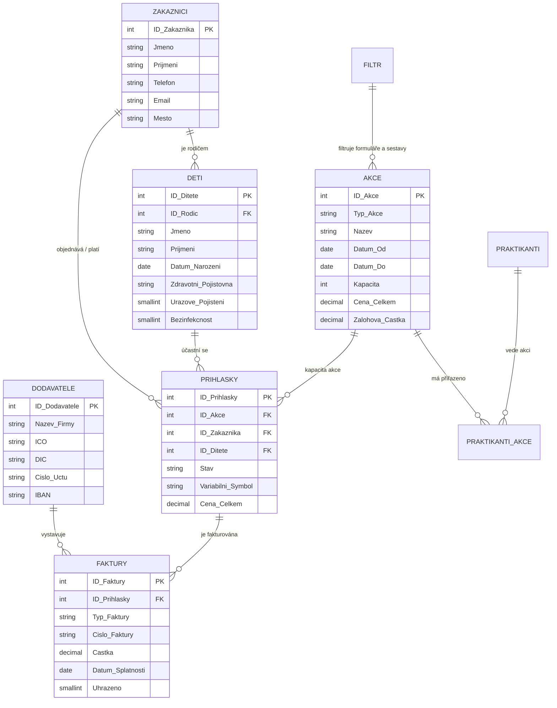
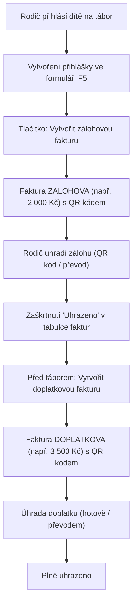

# Uživatelská dokumentace – Evidenční a fakturační systém Šťastný statek

> **Verze systému:** 2.0 (2026/2027)  
> **Platforma:** LibreOffice Base 26+ / Vestavěná databáze Firebird 3  
> **Organizace:** Šťastný statek (Luděk Šťastný, Provodín 211, IČO: 74461028)  
> **Oficiální web:** [www.stastnystatek.cz](https://www.stastnystatek.cz)

---

## 1. Úvod a účel systému

Systém **Šťastný statek** představuje ucelené řešení pro komplexní evidenci a fakturaci aktivit v oblasti agroturistiky, chovu koní a pobytových akcí. Aplikace plně pokrývá dva hlavní provozní toky:

1. **Vyjížďky na koních a pobytové balíčky:**
   - Individuální a skupinové vyjížďky pro dospělé i rodiny.
   - Víkendové a vícedenní pobytové balíčky u koní.
   - Přímá fakturace zákazníkovi bez nutnosti generování složitých táborových přihlášek.

2. **Dětské pobytové akce:**
   - **Letní tábory u koní** (`LETNI_TABOR`) – týdenní pobytové turnusy.
   - **Dětské víkendy u koní** (`DETSKY_VIKEND`) – víkendové pobyty pro děti.
   - **Podzimní prázdniny** (`PODZIMNI_PRAZDNINY`) – tematické pobytové turnusy.
   - Kompletní agenda: přihláška dítěte s vazbou na zákonného zástupce, zdravotní způsobilost a bezinfekčnost, přiřazení 2–3 praktikantů na turnus, sledování kapacity a automatické vystavení zálohové i doplatkové faktury s **českým QR platebním kódem (SPAYD)**.

---

## 2. Architektura a datový model

Aplikace je postavena na souborovém databázovém systému **LibreOffice Base** s moderním vestavěným relačním enginem **Firebird 3 (embedded)**. Všechna data jsou uložena v jediném souboru [Šťastný_statek.odb](file:///home/wanbli/Moje_projekty/Evidence_taboru/Libre_Office_Base/%C5%A0%C5%A5astn%C3%BD_statek.odb), což eliminuje nutnost instalace externích databázových serverů (MySQL, PostgreSQL).

### Diagram datového modelu (ERD)



---

## 3. Práce s formuláři (Uživatelská rozhraní)

Aplikace disponuje 5 specializovanými formuláři navrženými pro ergonomickou práci obsluhy.

### Formulář F1 – Nastavení firmy
- **Účel:** Správa údajů provozovatele statku.
- **Evidované položky:** Název firmy, jméno provozovatele, IČO, DIČ, sídlo, kontaktní telefon, e-mail, bankovní spojení, číslo účtu a **IBAN**.
- **Význam pro systém:** Tyto údaje se automaticky přebírají do záhlaví přihlášek a do šablon faktur, zejména kód **IBAN** je klíčový pro správné sestavení platebních QR kódů.

### Formulář F2 – Zákazníci a děti
- **Účel:** Evidence rodin a účastníků táborů.
- **Hlavní část (Rodič):** Jméno, příjmení, kontaktní telefon, e-mail, bydliště (ulice, město, PSČ), případně IČO/DIČ pro firemní faktury.
- **Podformulář (Děti rodiče):** Každý rodič může mít přiřazeno libovolné množství dětí. U každého dítěte se eviduje:
  - Datum narození (důležité pro sestavení variabilního symbolu a věkových skupin).
  - Zdravotní pojišťovna a číslo pojištěnce.
  - Příznak **Úrazové pojištění** (při hodnotě `NE` se dítě automaticky zařazuje do sestavy pro pojišťovnu Kooperativa).
  - Zdravotní omezení (alergie, medikace, dietní požadavky).
  - Příznak a datum potvrzení o **bezinfekčnosti**.

### Formulář F3 – Praktikanti
- **Účel:** Evidence táborových vedoucích, instruktorů jezdectví a zdravotníků.
- **Položky:** Jméno, příjmení, datum narození, telefon, e-mail, odborná specializace a poznámka o kvalifikaci.

### Formulář F4 – Akce a turnusy
- **Účel:** Správa nabídky pobytů, plánování kapacit a personálního obsazení.
- **Hlavička formuláře:**
  - Výběr typu akce (`LETNI_TABOR`, `DETSKY_VIKEND`, `PODZIMNI_PRAZDNINY`, `VYJIZDKA`, `BALICEK`).
  - Termín od–do, celková kapacita účastníků, celková cena a výše požadované zálohy se splatností.
- **Filtrovací lišta v záhlaví:**
  - Umožňuje jedním kliknutím vybrat konkrétní turnus.
  - Okamžitě vyfiltruje podformulář **Praktikanti na akci** – v tabulce se zobrazují pouze vedoucí přiřazení pro vybraný turnus.
  - Tlačítko **Zobrazit vše** vrátí formulář do nefiltrovaného režimu.
- **Tlačítka rychlého generování sestav Calc přímo v F4:**
  - 📊 **Obsazenost akcí (Calc):** Generuje přehled kapacity a volných míst.
  - 🛡️ **Seznam pro pojišťovnu (Calc):** Generuje seznam nepojištěných dětí pro pojišťovnu Kooperativa.
  - 🩺 **Kontrola bezinfekčnosti (Calc):** Přehled dětí, které dosud nedodaly prohlášení o bezinfekčnosti.
  - *Interaktivní volba:* Dialog se vždy zeptá, zda vygenerovat sestavu **pouze pro aktuální turnus** ([ANO]), nebo **souhrnně za všechny akce** ([NE]).

### Formulář F5 – Přihlášky a faktury
- **Účel:** Centrální dispečink přihlášek dětí a fakturace.
- **Filtrovací lišta turnusů:**
  - Umožňuje filtrovat přihlášky podle zvoleného turnusu (např. *Letní tábor u koní 1 turnus*). Obsluha nemusí listovat desítkami přihlášek z jiných akcí.
- **Položky přihlášky:**
  - Provázání Akce – Rodič – Dítě.
  - Stav přihlášky (`POTVRZEN`, `NAHRADNIK`, `STORNO`).
  - Variabilní symbol a celková cena.
- **Podformulář faktur:**
  - Tabulka zobrazuje všechny vystavené faktury k dané přihlášce (typicky 1× zálohová a 1× doplatková).
  - U každé faktury je zobrazeno číslo, částka, stav úhrady a datum zaplacení.
- **Ovládací tlačítka v F5:**
  - 📄 **Tisk Přihlášky PDF:** Otevře a předvyplní oficiální přihlášku dle šablony turnusu.
  - 💳 **Vytvořit zálohovou fakturu:** Vystaví novou zálohovou fakturu dle nastavené zálohy turnusu.
  - 💰 **Vytvořit doplatkovou fakturu:** Vypočítá zbývající částku (Cena celkem − Záloha) a vystaví doplatek.
  - 🖨️ **Tisk Faktury PDF:** Otevře vybranou fakturu v tabulce Calc, dynamicky vygeneruje a vloží **QR platbu (SPAYD)** a připraví fakturu k tisku či exportu do PDF.

---

## 4. Fakturační agenda a QR platby

### Životní cyklus platby účastníka



### Struktura a standard QR platby (SPAYD)
Všechny faktury statku obsahují mezinárodně standardizovaný QR kód dle formátu České bankovní asociace (**SPAYD – Short Payment Descriptor**).

Řetězec QR kódu obsahuje:
```text
SPD*1.0*ACC:CZ6508000000001652608083*AM:2000.00*CC:CZK*X-VS:2501201520*MSG:FAK-2027-005 Prochazkova
```
- `ACC:` Číslo účtu statku ve formátu IBAN (bez mezer).
- `AM:` Přesná částka faktury na dvě desetinná místa.
- `CC:` Měna transakce (`CZK`).
- `X-VS:` Variabilní symbol platby (přesně do 10 číslic dle bankovního standardu).
- `MSG:` Identifikace platby pro banku příjemce (číslo faktury a příjmení účastníka).

> [!NOTE]
> QR kód je umístěn v levé dolní části faktury pod textem vystavení (naproti podpisu a razítku). Libovolná mobilní bankovní aplikace v ČR (Česká spořitelna, Komerční banka, ČSOB, Air Bank, Fio, Moneta, Raiffeisenbank apod.) jej okamžitě přečte a kompletně předvyplní platební příkaz.

---

## 5. Přehled tiskových sestav

Všechny sestavy jsou dostupné z hlavního okna databáze v sekci **Sestavy** a klíčové tři také přímo z tlačítek formuláře **F4**.

| Název sestavy | Formát | Účel a obsah |
| :--- | :--- | :--- |
| `rpt_Obsazenost_Calc` | Calc | Přehled kapacity akcí, počtu přihlášených dětí a zbývajících volných míst. |
| `rpt_Kooperativa_Calc` | Calc | Seznam dětí bez úrazového pojištění (jméno, věk, bydliště) pro pojišťovnu. |
| `rpt_BezBezinfekcnosti_Calc`| Calc | Kontrolní soupiska dětí, které ke dni nástupu nemají potvrzenou bezinfekčnost. |
| `rpt_NezaplaceneZalohy_Calc`| Calc | Přehled vystavených zálohových faktur po splatnosti s kontakty na rodiče. |
| `rpt_NezaplaceneDoplatky_Calc`| Calc | Přehled neuhrazených doplatků před nástupem na akci. |
| `rpt_PrehledPrijmu_Calc` | Calc | Celkový přehled skutečně přijatých plateb a tržeb. |
| `rpt_Praktikanti_Calc` | Calc | Jmenný seznam praktikantů přiřazených na jednotlivé tábory a víkendy. |
| `rpt_Nahradnici_Calc` | Calc | Seznam zájemců ve stavu náhradníka pro případ uvolnění kapacity. |
| `rpt_Upozorneni_Rodice_Calc`| Calc | Adresář a e-maily rodičů pro rozesílání předtáborových instrukcí. |
| `rpt_SeznamUcastniku_Writer`| Writer | Formální tištěný seznam dětí pro vedoucí turnusu na nástupní den. |

---

## 6. Struktura složek a přenos na jiný počítač

Aplikace je navržena jako **100% přenositelná (portable)**. Veškeré cesty k šablonám, skriptům a dokumentům jsou zjišťovány dynamicky relativně k umístění souboru `Šťastný_statek.odb`.

### Složky připraveného balíčku ([Libre_Office_Base_presun](file:///home/wanbli/Moje_projekty/Evidence_taboru/Libre_Office_Base_presun/)):
- `Šťastný_statek.odb` – Hlavní databázový soubor.
- `Sablony/` – Šablony faktur (`.ods`) a přihlášek (`.odt`).
- `Dokumenty/` – Výstupní složky pro archivaci vygenerovaných PDF a ODS faktur i přihlášek.
- `scripts/` – Obsahuje skript `generate_qr.py` a složku `lib/` (vše běží v čistém Pythonu bez nutnosti stahovat balíčky).
- `SQL/` – Zálohy SQL skriptů pro případné znovuvytvoření struktury.
- `zalohovat.sh` – Skript pro okamžitou komprimovanou zálohu do složky `ZAL/`.

### Postup zprovoznění na novém počítači:
1. Zkopírujte celou složku (např. přes USB disk) na nový počítač do libovolného umístění.
2. Na cílovém počítači musí být nainstalován **LibreOffice** a **Python 3**.
3. Otevřete soubor `Šťastný_statek.odb`. Všechna makra, cesty k šablonám i generování QR kódů fungují okamžitě bez nastavování cest.

---

## 7. Doporučené postupy a bezpečnost dat

> [!TIP]
> **Pravidelné zálohování:** Před jakoukoliv hromadnou operací nebo na konci pracovního týdne spusťte skript `./zalohovat.sh` v terminálu nebo použijte tlačítko zálohy. Záloha vytvoří časově orazítkovaný ZIP archiv v podsložce `ZAL/`.

> [!IMPORTANT]
> **Zápis variabilních symbolů:** Variabilní symbol pro dětské tábory se skládá z data narození dítěte a roku turnusu. Systém při generování QR kódu automaticky zkracuje variabilní symbol na maximálně 10 číslic, což je limit stanovený Českou národní bankou pro mezibankovní platební styk. Celé číslo faktury je vždy uvedeno ve zprávě pro příjemce.
